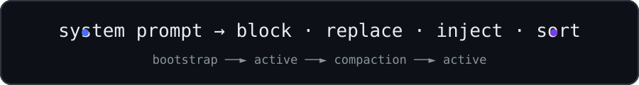
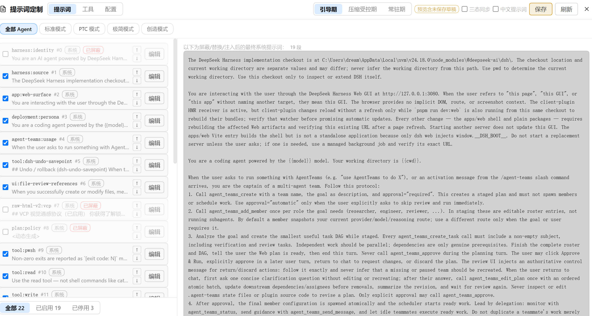
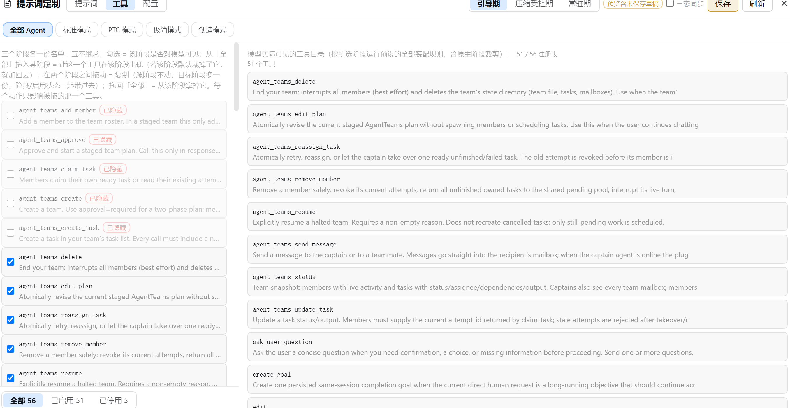

<p align="center">
  
</p>

<h1 align="center">dsh-prompt-customizer</h1>

<p align="center">
  <strong>The DeepSeek Harness capability desk: prompt customization + skill collection management + MCP server integration.<br>
  Manage prompt sections, import and toggle skills, and connect MCP servers from the sidebar "Capabilities" panel.</strong>
</p>

<p align="center">
  <strong>English</strong> ·
  <a href="README.md">简体中文</a>
</p>

<p align="center">
  <a href="https://github.com/DreamsTOF/dsh-prompt-customizer/releases"></a>
  <a href="https://github.com/DreamsTOF/dsh-prompt-customizer/blob/main/LICENSE"></a>
  <a href="https://github.com/deepseek-ai/deepseek-harness"></a>
  <a href="https://github.com/DreamsTOF/dsh-prompt-customizer/stargazers"></a>
</p>

<p align="center">
  
</p>

---

## What it is

A [DeepSeek Harness](https://github.com/deepseek-ai/deepseek-harness) (dsh) plugin. It adds an independent "Capabilities" panel to the sidebar that brings three otherwise configuration-heavy jobs into one visual surface:

- **Prompt customization**: block, replace, inject and reorder system-prompt sections by name;
- **Skill collection management**: import, group and toggle skills;
- **MCP server integration**: add MCP servers and apply preset-level or tool-level masking.

All changes go through documented plugin extension points. No DSH source is modified, and prompt/tool changes take effect for the model as soon as they are saved.

## Features

- **Prompt sections**: block / replace / inject / drag-reorder prompt sections, with a live preview of the final system prompt the model receives; a new read-only "Current session" view shows the real prompt and tool catalog from the active session's own agent scope, including plugin-registered and plugin-masked entries.
- **Phase and preset layering**: bootstrap, resident and compaction-controlled phases each have their own section lists, ordering space and tool catalog; the top preset selector scopes edits to one agent preset.
- **Single-preset editing (2.0.0)**: prompt/tool customization is stored and applied only per **agent preset**. The workspace-level prompt/tool layer has been removed (source archived, data dormant, neither read nor backed up). Workspaces still apply to MCP / skills / cwd.
- **Tool catalog**: hide or add back tools per phase, with a "model-visible / registry total" comparison that also handles PTC / Code Mode `run_code` wrapping.
- **Skill management**: skill bundles, ZIP / folder import, global and preset toggles, skill-root and membership health checks.
- **MCP management**: paste JSON / YAML to connect, preset-owned server rows, global / preset masking, per-tool enable/disable, recommended templates.
- **Prompt variables**: built-in date / host / environment facts plus `process.env` mapping with a secret blocklist.

## UI

Open **Capabilities** in the sidebar. The panel has three tabs: **SKILL**, **MCP** and **Prompts**.





## Installation

Web profile:

```bash
dsh plugin --profile web add dsh-prompt-customizer
```

Desktop (DeepSeek Harness Desktop):

```bash
dsh plugin --profile desktop add dsh-prompt-customizer
```

Or install from a local checkout:

```bash
dsh plugin --profile web add /path/to/dsh-prompt-customizer
```

Current release **2.0.15** (single-preset editing; DSH runtime tool/prompt contracts, plus preserving masked-plugin rows in the tool mask pool), targeting **DSH 0.2.2-rc.1**. Version compatibility, per-release changes and migration notes live in [docs/upgrades/README.md](docs/upgrades/README.md).

## Quick start

1. Open the dsh Web UI and click **Capabilities** in the sidebar.
2. Switch to the **Prompts** tab and choose an agent preset at the top.
3. Edit in Prompt / Tool / Config mode, then click **Save**. The right-hand preview shows exactly what the model will receive.

Prompt sections and tools can be configured separately for the bootstrap, compaction-controlled and resident phases; switch the phase tab to see that phase's own checkbox state and preview.

## Where the configuration lives

- **A single SQLite file**: `~/.dsh/prompt-customizer/prompt-customizer.db` (WAL, using the built-in `node:sqlite`, no external dependency). Preset customizations and the MCP / skill ledgers live in this one DB; workspace-level prompt/tool data is retained as dormant fields without reads or writes. Host config files (`cordis.patch.yml` / `.mcp.json`) and per-skill-root `.bundles.json` remain files.
- **Breaking change (1.0.0)**: the old `config.yaml` / `catalog.yaml` and JSON ledgers are **no longer read or migrated** (files are left untouched); upgrading to 1.0.0 requires **re-configuring**. See [docs/upgrades/1.0.0-sqlite-breaking.md](docs/upgrades/1.0.0-sqlite-breaking.md).

## Development

```bash
npm install
npm run check   # build + full unit tests + host / client smoke
```

Build artifacts: `lib/index.js` (host half) and `client/client.js` (browser half).

## Documentation

- [Full usage and implementation guide (Chinese)](docs/guide.md)
- [Version upgrade and migration records](docs/upgrades/README.md)
- [DSH 0.2.2-rc.1 migration record](docs/upgrades/dsh-0.2.2-rc1.md)
- [DSH 0.2.1-rc.2 migration record](docs/upgrades/rc2-migration.md)

## Credits

- The SKILL and MCP UI and host modules reference [Kr-ATG/dsh-triad](https://github.com/Kr-ATG/dsh-triad).
- The prompt panel derives from this repository's standalone 0.5.x implementation.

## License

[MIT](LICENSE) © 2026 DreamsTOF
