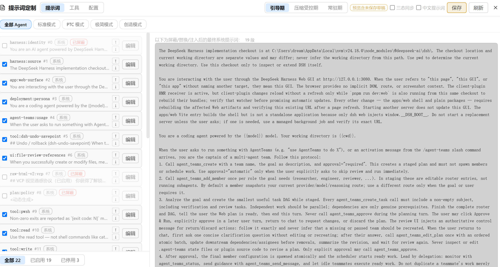
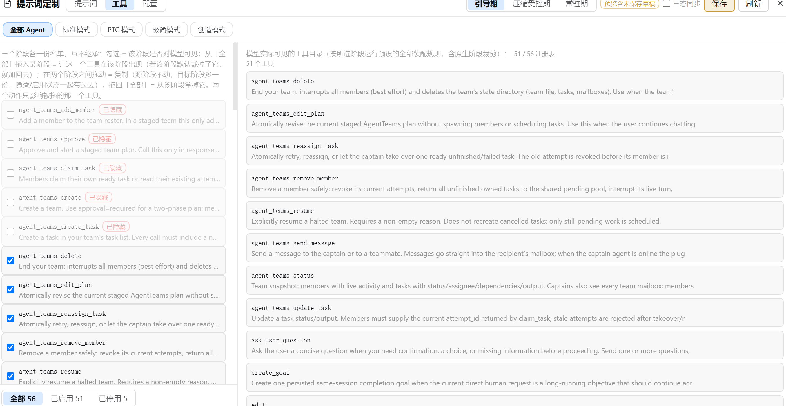

<p align="center">
  
</p>

<h1 align="center">dsh-prompt-customizer</h1>

<p align="center">
  <strong>DeepSeek Harness 的能力台：提示词定制 + 技能集合管理 + MCP Server 接入。<br>
  在侧边栏的「能力」面板里完成提示词段管理、技能导入与开关、MCP 接入与分层遮蔽。</strong>
</p>

<p align="center">
  <a href="README.en.md">English</a> ·
  <strong>简体中文</strong>
</p>

<p align="center">
  <a href="#这是什么">这是什么</a> •
  <a href="#核心能力">核心能力</a> •
  <a href="#安装">安装</a> •
  <a href="#快速上手">快速上手</a> •
  <a href="#文档">文档</a>
</p>

<p align="center">
  <a href="https://github.com/DreamsTOF/dsh-prompt-customizer/releases"></a>
  <a href="https://github.com/DreamsTOF/dsh-prompt-customizer/blob/main/LICENSE"></a>
  <a href="https://github.com/deepseek-ai/deepseek-harness"></a>
  <a href="https://github.com/DreamsTOF/dsh-prompt-customizer/stargazers"></a>
</p>

<p align="center">
  <b>⭐ GitHub 仓库：<a href="https://github.com/DreamsTOF/dsh-prompt-customizer">DreamsTOF/dsh-prompt-customizer</a></b> —— 觉得有用就点个 Star；问题与需求请提 <a href="https://github.com/DreamsTOF/dsh-prompt-customizer/issues">Issue</a>
</p>

<p align="center">
  
</p>

---

## 这是什么

一个 [DeepSeek Harness](https://github.com/deepseek-ai/deepseek-harness)（dsh）插件。它在侧边栏提供一个独立的「能力」面板，把三件平时要改配置、翻源码才能完成的事集中到可视化界面：

- **提示词定制**：按名称屏蔽、替换、注入、排序系统提示词段；
- **技能集合管理**：导入、归组、开关技能；
- **MCP Server 接入**：添加 MCP Server，并按预设或工具粒度做遮蔽与启停。

所有改动都通过插件自身的扩展点生效，不修改 DSH 源码；提示词与工具目录在保存后实时作用于模型。

## 核心能力

- **提示词段管理**：屏蔽 / 替换 / 注入 / 拖动排序提示词段，右栏实时预览模型最终看到的系统提示词；新增「当前会话」只读视图，按活动会话自己的 agent 作用域展示真实提示词与工具目录（含插件动态注册 / 遮蔽的条目）。
- **阶段与预设分层**：引导期、常驻期、压缩受控期各有独立的段名单、排序空间与工具目录；顶部按 agent 预设切换编辑目标，某个预设的定制只对该预设生效。
- **单预设编辑（2.0.0）**：提示词 / 工具定制只按 **agent 预设** 保存与生效；工作区级提示词/工具层已移除（源码归档、数据休眠，不读不写不备份）。工作区概念仍用于 MCP / 技能 / cwd。
- **工具目录**：按阶段隐藏或加回工具，面板同时显示「模型可见 / 注册表总数」，PTC / Code Mode 的 `run_code` 包装也能正确对照。
- **技能管理**：技能包归组、ZIP / 文件夹导入、全局 / 预设两层开关、技能根与成员一致性体检。
- **MCP 管理**：粘贴 JSON / YAML 接入、预设专属 Server 行、全局 / 预设双层遮蔽、工具级启停、推荐配置模板。
- **提示词变量**：内置日期、主机、环境等变量，支持 `process.env` 映射与密钥黑名单。

## 界面

侧边栏点 **能力** 打开面板，顶部三个 tab：**SKILL**、**MCP**、**提示词**。





## 安装

Web profile：

```bash
dsh plugin --profile web add dsh-prompt-customizer
```

桌面端（DeepSeek Harness Desktop）：

```bash
dsh plugin --profile desktop add dsh-prompt-customizer
```

也可从本地检出安装：

```bash
dsh plugin --profile web add /path/to/dsh-prompt-customizer
```

当前版本 **2.0.16**（单预设编辑；按 DSH 运行时契约泛化工具与提示词接管；工具屏蔽池、工作区技能状态、汇总缓存和写队列回归已补齐）。版本对应关系、逐版变更和适配记录见 [docs/upgrades/README.md](docs/upgrades/README.md)。

## 快速上手

1. 打开 dsh Web UI，侧边栏点 **能力**。
2. 选择 **提示词** tab，在顶部选择要编辑的 agent 预设。
3. 在提示词 / 工具 / 配置三种模式里调整，点 **保存** 生效；右栏预览会实时显示模型最终收到的内容。

提示词与工具支持按「引导期 / 压缩受控期 / 常驻期」分别配置；切换阶段 Tab 即可看到该阶段独立的勾选状态与预览。

## 配置位置

- **统一为单文件 SQLite**：`~/.dsh/prompt-customizer/prompt-customizer.db`（WAL，使用 Node 内建 `node:sqlite`，无外部依赖）。预设定制、MCP 与技能各账本都在这一个库里；工作区级提示词/工具数据作为休眠字段保留但不读不写。宿主配置文件（`cordis.patch.yml` / `.mcp.json`）与技能根下的 `.bundles.json` 仍保持文件。
- **破坏式更新（1.0.0）**：旧版 `config.yaml` / `catalog.yaml` 及各 JSON 账本**不再读取、不迁移**（文件原样保留）；升级到 1.0.0 需**重新配置**。详见 [docs/upgrades/1.0.0-sqlite-breaking.md](docs/upgrades/1.0.0-sqlite-breaking.md)。

## 开发

```bash
npm install
npm run check   # 构建 + 全量单测 + 宿主 / 客户端 smoke
```

构建产物：`lib/index.js`（宿主半身）与 `client/client.js`（浏览器半身）。

## 文档

- [完整使用与实现指南](docs/guide.md)
- [版本升级与适配记录](docs/upgrades/README.md)
- [DSH 0.2.2-rc.1 适配记录](docs/upgrades/dsh-0.2.2-rc1.md)
- [DSH 0.2.1-rc.2 适配记录](docs/upgrades/rc2-migration.md)

## 致谢

- 技能（SKILL）与 MCP 两块的界面与宿主模块参考 [Kr-ATG/dsh-triad](https://github.com/Kr-ATG/dsh-triad)。
- 提示词面板派生自本仓库 0.5.x 的独立实现。

## License

[MIT](LICENSE) © 2026 DreamsTOF

---

[](https://star-history.com/#DreamsTOF/dsh-prompt-customizer&Date)
