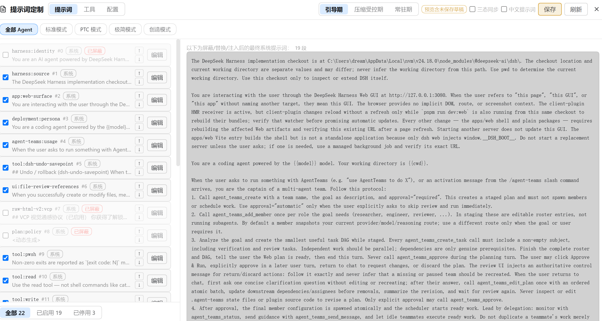
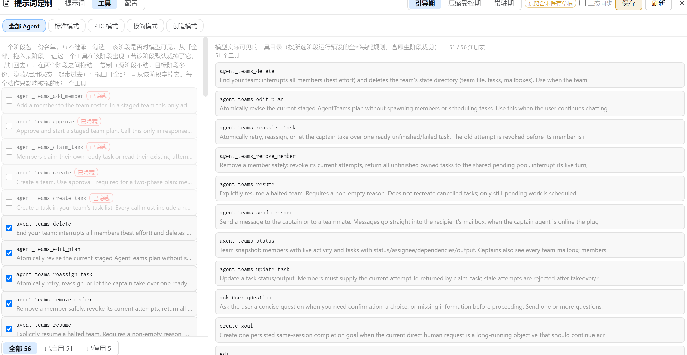

<p align="center">
  
</p>

<h1 align="center">dsh-prompt-customizer</h1>

<p align="center">
  <strong>DeepSeek Harness 的能力台：提示词定制 + 技能集合管理 + MCP Server 接入。<br>
  按名称屏蔽 / 替换 / 注入 / 排序提示词段（按会话阶段与 agent 预设分层）、导入 / 分组 / 开关技能、接入 MCP 并做分层遮蔽与工具级启停 —— 全部在侧边栏的「能力」面板里完成。</strong>
</p>

<p align="center">
  <a href="README.en.md">English</a> ·
  <strong>简体中文</strong>
</p>

<p align="center">
  <a href="#安装">安装</a> •
  <a href="#功能特性">功能特性</a> •
  <a href="#使用说明">使用说明</a> •
  <a href="#工作原理">工作原理</a> •
  <a href="#已知限制">已知限制</a>
</p>

<p align="center">
  <a href="https://github.com/DreamsTOF/dsh-prompt-customizer/releases"></a>
  <a href="https://github.com/DreamsTOF/dsh-prompt-customizer/blob/main/LICENSE"></a>
  <a href="https://github.com/deepseek-ai/deepseek-harness"></a>
  <a href="https://www.npmjs.com/package/dsh-prompt-customizer"></a>
  <a href="https://www.npmjs.com/package/dsh-prompt-customizer"></a>
  <a href="https://github.com/DreamsTOF/dsh-prompt-customizer/stargazers"></a>
</p>

<p align="center">
  <b>⭐ GitHub 仓库：<a href="https://github.com/DreamsTOF/dsh-prompt-customizer">DreamsTOF/dsh-prompt-customizer</a></b> —— 觉得有用就点个 Star；问题与需求请提 <a href="https://github.com/DreamsTOF/dsh-prompt-customizer/issues">Issue</a>
</p>

<p align="center">
  
</p>

---

## 在线试玩：仓库概览 galgame

本仓库被做成了可游玩的 [WebGAL](https://github.com/OpenWebGAL/WebGAL) 视觉小说：**138 个节拍、一次分支选择**，由项目化身「dsh-prompt-customizer」与「JavaScript」带你走完 —— 这个插件是什么、核心功能怎么用、怎么安装、目录地图、工作原理和已知限制。

<p align="center">
  <a href="https://dreamstof.github.io/dsh-prompt-customizer/"><b>▶ 立即在线游玩</b></a>
</p>

- 在线版：<https://dreamstof.github.io/dsh-prompt-customizer/>（站点源在 [`gh-pages`](https://github.com/DreamsTOF/dsh-prompt-customizer/tree/gh-pages) 分支）
- 本地版：克隆 `gh-pages` 单分支后在目录里起一个静态服务器，例如 `python -m http.server 8000`，再打开 `http://localhost:8000`

---

一个 [DeepSeek Harness](https://github.com/deepseek-ai/deepseek-harness) (dsh) 插件，让你在侧边栏的独立面板里控制**系统提示词**和**工具目录**（仿宿主能力管理页：顶部 agent 预设 Tab、左栏勾选列表 + 底部三态过滤、右栏实时预览）。

其他插件注入的提示词段可能污染你的系统提示词。本插件让你按名称**屏蔽**、**替换**、**注入**、**排序**提示词段，并把工具从**模型可见目录**里隐藏 —— 全程实时生效，不需要改动任何其他插件。

两件事贯穿整个设计：

- **按会话阶段分层**：引导期（未晋级）/ 常驻期（晋级后）/ 压缩受控期（压缩后仍未晋级）各有**独立的屏蔽名单、独立的排序空间、独立的工具目录**。同一个预设可以做到首轮只给模型 1 个工具和几段提示词，晋级后放开全套。
- **按 agent 预设分层**：顶部预设 Tab 选中某个 agent 预设后，改动只对该预设生效；**0.9.0 起「全部 Agent」全局层停用**——提示词必须按具体预设修改，预设未定制的字段 = 官方默认（旧全局层数据保留在 config.yaml 里不再生效，可手编回滚）。

## 0.11.6：测试精简（176 → 117 用例）

两轮清理，`node --test` 始终全绿：

1. **删除 6 个过时测试文件**（−19%）：`scripts/test-mcp-layering.mjs`、`scripts/test-mcp-tool-disable.mjs`（0.11.0 已废弃的 mcp-client 行挂载模型）、`scripts/test-skill-toggles.mjs`（旧 frontmatter 语义，与现有覆盖重复）、`scripts/test-rc2-runtime.mjs`（硬编码只认 0.2.0-rc.2，自述在 0.2.1-rc.2 上必然失败）、`test/catalog-replace.test.mjs`（mergeSighting 与 `catalog.test.mjs` 逐条重复）、`test/live-preview.test.mjs`（被 `rc2-preview` / `apply-route` 覆盖）。
2. **同组用例参数化合并**（−27%）：结构相同的多个 `test()` 合并为「数据表 + 循环」，每个表项执行原用例的**全部**断言，并给断言传场景 label（失败时能看出是哪一项）。涉及 `sectionOps`（27→24）、`chaos-super`（17→11）、`catalog`（11→2）、`effective`（8→2）、`preview-phase`（9→6）、`rc2-preview`（9→7）、`schema`（7→4）、`trust-gate`（3→1）、`windows-titlebar`（3→2）等 16 个文件。

**没有删除或弱化任何断言**：合并处逐条 diff 核对过输入表（文件名净化仍覆盖 5 个原始输入、`isTauriEnv` 仍覆盖 6 个探针、trust-gate 三种拒绝各自仍校验「不得写盘」）。生产代码零改动。

保留的「看起来可疑但必要」：`test/mcp-workspace-scope.test.mjs` 测的是 0.11.4 的 `src/mcp-workspace-scope.ts`（不是已删的 `mcp-workspace.ts`），`host.ts` 至今仍在 import 它。

## 0.11.5：工作区 MCP 落盘改为主流 agent 通用的 `.mcp.json`

- **格式对齐大众 agent**：工作区「添加 MCP」不再写 DSH 私有的 `patch.yml`，改写项目根的 **`.mcp.json`**（`{ "mcpServers": { <name>: { command|url, … } } }`）—— Claude Desktop / Cursor / Cline 等直接就能读。
  - **第一次是新建**，后续在同一个文件里**追加**（保留已有 server、保留用户手写的其它顶层字段）。
  - 同名已存在 → 跳过，不覆盖用户内容；文件是坏 JSON → 报错并拒绝写入，绝不覆盖。
- **读取时转换**：内部仍按 `mcp-client` 行挂载，读 `.mcp.json` 时把键名当 serverName 并加工作区哈希后缀（同名跨工作区不冲突），`command/args/env/cwd/url/headers` 原样透传。
- **全局不转**：全局添加仍写 profile patch（DSH 自己的组合层），保持原行为。
- **去重按目标文件算**：工作区只和该工作区 `.mcp.json` 里的键比，不再因为「全局已有 anysearch」把工作区的同名项误判为重复。
- **验证**：新增 `test/workspace-mcp-json.test.mjs`（新建 / 追加 / 同名不覆盖 / 保留其它顶层字段 / 坏 JSON / 读回转换）；`node --test` 176/176。接口实测：连续两次添加落在同一 `.mcp.json`，内容为标准格式（无 `serverName`/`transport` 等内部字段）；全局添加仍写 profile patch。

## 0.11.4：添加技能 / MCP 可选「全局 / 当前工作区」

- **添加入口加落点选择**：默认 **全局**，可选 **当前工作区**。
  - 技能：全局写 `~/.agents/skills`；工作区写 `<ws>/.agents/skills`，**目录不存在自动创建**（全新工作区也能直接装）。
  - MCP：全局写 profile patch；工作区写 `<ws>/.dsh/mcp.patch.yml`（新文件，同样自动建目录），由装配按该工作区会话挂载 —— 同一个 `anysearch` 可在两个工作区各配一份，互不覆盖。（**0.11.5 起工作区落盘已改为项目根的标准 `.mcp.json`，见上节。**）
- **缺 workspace 时明确报错**：`scope=workspace` 但没给路径 → 400，不会悄悄退回全局。
- **验证**：新增 `test/add-scope.test.mjs`（默认全局 / 工作区自动建目录 / 工作区不污染全局 / 缺参数报错）；`node --test` 174/174。接口实测：工作区装技能落到 `<ws>/.agents/skills/zz-ui-ws/SKILL.md` 且全局无残留；工作区加 MCP 落到 `<ws>/.dsh/mcp.patch.yml` 且 profile patch 无污染。

## 0.11.3：工作区下拉能列出全部工作区，技能按工作区真实切换

- **下拉只有「跟随当前会话」一项** → 修好：选项改从内核 `workspaceRegistry.list()`（侧边栏里用户登记的全部工作区）取，再补活动会话 cwd 与启动目录。没开过会话的工作区现在也能选（实测列出 5 个：PatientLifecycle / dsh-pulgn / bot / rea / 默认工作区）。
- **切工作区后技能不跟着变** → 修好：内核 `skill-filesystem` / `skill-office` 是**挂在预设行里**的 provider（`apply(ctx)` 注册进该行的层），只有「存在会话 + scope 命中预设层」时才读得到；面板要给任意工作区配置，因此改为
  - 内核结果**完整**（有会话且出现 `project-*`/`user-*`/`custom` 来源）时以内核为准；
  - 否则按内核同一套根规则兜底扫描 `<ws>/.dsh/skills` → `<ws>/.agents/skills` → `~/.dsh/skills` → `~/.agents/skills`，再把内核独有的条目（bundled / office / 插件 provider）补在后面。
- **验证**：往临时工作区放一个探针技能，该工作区 7 个、dsh-pulgn 仍 6 个（不串）；`node --test` 172/172。

## 0.11.2：面板内切换工作区 + 工作区/全局标注 + 工作区级 MCP 关闭

- **顶栏工作区选择器**：放在 SKILL / MCP / 提示词 那一行右侧（不在操作行）—— 它同时决定技能目录与 MCP 注入，必须一眼可见。选项来自宿主（活动会话 cwd ∪ 启动目录），默认「跟随当前会话」。
- **技能与 MCP 都标来源**：卡片上新增「工作区 / 全局」标签。技能来源取内核 `source`（`project-*` = 工作区专用，其余 = 全局）；MCP 行都是组合行，标「全局」。同名时工作区优先，关全局不影响工作区专用条目。
- **工作区级 MCP 关闭**：每张 MCP 卡片新增「本工作区关闭 / 本工作区启用」。账本写 `<agentsHome>/skills/.workspace-mcp.json`（`{ 工作区: { serverName: false } }`），由 `system-prompt/assemble` 按该次装配所属会话的 cwd 剔除 `mcp__<server>__<tool>`。
  - 关掉 dsh-pulgn 的 `anysearch` → 该工作区不再注入；换到别的工作区照常注入（**工具集合随工作区变化**），其它工作区不受影响。
  - 与「全局停用」（改 profile patch 的 `disabled`）互不干扰：一个是所有人的默认，一个只针对某个工作区。
- **修一个写入缺陷**：Windows 上 `rename` 覆盖已存在的账本会 `EPERM`，导致同一工作区第二次调整失败。改为「先删旧文件再改名，失败退化为直接写」，并补了「关→开→再关」的回归测试。
- **验证**：`node --test` 172/172（新增 `test/mcp-workspace-scope.test.mjs` 覆盖工作区隔离与连续写入）；web 实例真浏览器实测：顶栏出现工作区下拉，技能卡片显示「全局」，MCP 卡片显示「全局」+「本工作区已关」，点「本工作区关闭」后账本落盘、`status?cwd=` 回报 `closed:["anysearch"]`、换工作区 `closed:[]`。

## 0.11.1：修技能目录只见 global 层 + 开关改为「全权接管、无只读」

- **修「斜杠命令能看到 5 个技能，能力栏只有 1 个」**：内核 registry 的读取是 `[global 层, ...chainLayers(scope)]`（`packages/skill/skill/src/index.ts:556`）—— **不传 `scope` 就只读 global 层**。技能绝大多数注册在预设/agent 层，于是面板只剩随安装的那个 bundled 技能。现在把该 agent 的 scope key（agent 对象本身，`createScope(loopCtx, this)`）传给 `list()`，面板与 `/` 菜单、上下文里的「技能注入」条数一致。
- **开关改为隐藏账本，不再改用户的 SKILL.md**：全局开关写 `<agentsHome>/skills/.hidden-skills.json`，由闸门 provider 在内核目录里遮掉。好处是**所有来源**（含 `app.asar` 内随安装技能、office 包、插件自带）都能关，且随时可逆、不动别人的文件。
- **取消「只读」概念**：面板不再区分来源，任何技能都能开关；删除仍然只对真正可写根生效（随安装的技能删不掉文件），此时返回明确提示「该技能随安装/插件提供，请改为关闭」。
- **双保险**：除闸门 provider 外，面板目录（`kernel-skills`）自己也按隐藏账本过滤一次 —— 内核合并只按层/rank 去重，同名候选未必每次压过真实来源。

## 0.11.0：技能目录直接读内核，MCP 只留组合行

方向调整：**不再自搓扫描**。内核已经有「聚合全部技能来源」的服务与「组合行」这一层配置模型，插件自扫只会在根顺序、去重、只读来源上不断与内核打架。

- **技能列表 = 内核真值**：面板改为 `agent.ctx.skills.list({ cwd })`（`packages/skill/skill/src/index.ts`）—— 文件系统各根（project-dsh / project-agents / custom / user-dsh / user-agents）+ `bundled` + `runtime`（office 包）+ 插件自注册 provider，全由内核按 scope 链与 cwd 聚合。**面板显示的就是模型这一会话能用的那一份**（与右侧「上下文 → 技能注入」条数一致）。
  - 选哪个会话：取最新创建的根会话（`agents.roots()` 按 `session.header.createdAt` 降序）；客户端目前读不到渲染期的当前会话 id（`uiSession` 是 hook/selector 面），因此面板以「最新会话」为准。无会话时退回宿主全局 `ctx.skills` + 启动 cwd。
  - （只读分级已在 0.11.1 取消：所有来源的技能都能开关，见上节。）
- **MCP 不再有目录层**：删掉 0.10.x 的 `mcps/` 四目录扫描、挂载、可见性过滤与面板分区。MCP Server 就是内核 Cordis 组合里的 `mcp-client` 行 —— 列表、启停、增删都走组合行（`pluginManager.listPlugins()` / `setPluginEnabled()` 与 `configEditor`），插件不再额外挂行。
- **验证**：`node --test` 全绿；web 实例真浏览器实测（注入的 bsk 工具）：MCP 页只有 3 个组合行、无「mcps 目录」分区、不闪退。
- **已知限制**：随安装发布的技能在 `app.asar` 内，文件清单读不到（卡片显示「0 文件」）；不同 profile/预设的组合不同，所以各处的技能数量天然不同（这不是漏扫）。

## 0.10.1：修复 MCP 页闪退 + 技能/MCP 统一为「四个目录、`.dsh` 优先」

- **修复「点 MCP tab 闪退回对话界面」**：0.10.0 的 MCP 页新增分组时，图标随手写成 `IconFolderOutlineRegular`，而宿主 `@deepseek-ai/dsh-client-ui-primitives` 并未导出这个名字 —— 该 JSX 组件是 `undefined`，React 抛 `Element type is invalid`，MCP 页被 ErrorBoundary 摘掉（面板 fallback `null` + 自动关闭 = 闪退回对话界面）。改用宿主确实导出、或插件自绘的图标。
- **补上静态护栏**，让「宿主没有这个图标」在提交前就失败：`test/client-primitives.test.mjs` 检查客户端从 ui-primitives 导入的每个名字都在 `test/fixtures/client-ui-primitives.json` 白名单里，并逐名核对宿主打包产物确实存在（标识符边界匹配，防止 `IconFolderOpenOutline` 蹭到 `IconFolderOpenOutlineRegular` 而误判）。
- **补上真浏览器验证**：新增 `scripts/verify-panel-browser.mjs` —— 用真实 Chrome（CDP，无第三方依赖）打开 dsh Web UI，点「能力」→ MCP 页 → SKILL 页，断言没有未捕获异常、MCP 页真的渲染出来、四个目录里的条目都在 DOM 里，并截图留证。闪退这类问题只有真渲染才会暴露，单测全绿也拦不住。
- **技能与 MCP 统一为四个目录**（`.dsh` 优先于 `.agents`，工作区优先于用户级）：
  - 技能：`<工作区>/.dsh/skills` → `<工作区>/.agents/skills` → `~/.dsh/skills` → `~/.agents/skills`
  - MCP：`<工作区>/.dsh/mcps` → `<工作区>/.agents/mcps` → `~/.dsh/mcps` → `~/.agents/mcps`
  - 同名先出现者胜出：技能按名字去重（先出现的那份胜出）；MCP 同一作用域内同名只挂一台，被遮蔽的在面板里如实标出「同名遮蔽（来自哪个文件 → 采用了哪个文件）」。
  - 技能根**不再按「目录是否存在」过滤**：四个根始终在列表里，新丢进去的技能下一次请求即可见，不必重开会话。

## 0.10.0：技能扫工作区级根 + mcps 目录接上

- **技能面板补上工作区级技能根**：内核 `dsh-skill-filesystem` 扫 5 类根，本插件面板此前只认两个用户级根，于是 `<工作区>/.dsh/skills` 与 `<工作区>/.agents/skills` 里的技能内核看得见、面板看不见（无法归组 / 开关 / 查看文件）。现在面板、技能开关、技能健康三处共用同一份根集合，顺序与内核 rank 一致（工作区级先于用户级，同名先出现者胜出），项目根按内核规则取「最近的含 `.git` 的祖先，没有则会话 cwd」。
- **补上 mcps 目录的 MCP Server**：内核只认 Cordis 组合里的 `mcp-client` 行，没有「读某个目录下 `mcp.json`」的约定（全仓库 grep `mcps` 零命中），所以 `~/.agents/mcps/**`、`<工作区>/.dsh|.agents/mcps/**` 里放着的配置一直是死文件。现在由本插件读出来挂成真正的 mcp-client 行：全局层所有会话可见，工作区层只在该工作区会话可见（装配时按会话 cwd 过滤），MCP 页单列一组展示。
- 工作区层的 `serverName` 追加 8 位路径哈希后缀：不同工作区可以各配一台同名但参数不同的 Server，互不挤占（`mcp-client` 的 serverName 在同一作用域只能有一个实例）。配置里的 `${VAR}` 按进程环境展开，`cwd` 的相对值按该配置文件所在目录解析。
- 与组合里既有的行同名时**以组合为准**：目录里那条不重复挂载，面板如实标出「已让位」—— 否则后挂的 fiber 激活失败并持续报 `serverName ... is already in use`。
- 相关实现：新增 `src/skill-roots.ts`（根解析）与 `src/mcp-workspace.ts`（mcps 运行时），`vendor/skill-manager/skills-host.js` 增加额外根注入，路由 `GET /api/triad/mcp-workspace/status`；`/api/triad/mcp-status` 增加 `workspaceServers` 段。

## 0.9.3：适配 DSH 0.2.1-rc.2

- **修复「存为预设」**：原实现调用宿主 `agentPresets.copy()`，但该 API 在 DSH 任何版本都不存在（宿主只有 `list` / `read` / `select`），所以此前一保存就报 `宿主未提供 agent 预设服务`。现改为读来源预设的声明组成，作为一条 `dsh-agent-preset` 行写进 profile patch（HMR 热加载），并把当前定制写进 `overrides[新名]`。
- 预设 id 收紧为宿主的真实规则 `[a-z0-9][a-z0-9-]*`（原先允许中文与空格，与宿主不符）。
- 用户数据根解析对齐内核新的 `resolveDshHome` / `resolveAgentsHome`：`$DSH_HOME` / `$DSH_AGENTS_HOME` 为空串或纯空白时按未设置处理（旧写法会落到进程 cwd），`~` / `~/` 前缀现在展开。技能面板、技能开关账本、技能健康检查三处共用 `src/home-paths.ts`。
- 三个功能面的服务契约在本区间零破坏：`ctx.skills`、`tools.restrict/schemas`、`configEditor`、`agentPresets`、`system-prompt` 装配 waterfall 与段/变量 API、`connection.requestRejection` 全部保持。详见 `docs/rc2-migration.md`。

## 0.9.2：按模式预设修正 rc.2 适配

- 预设目录使用 `agentPresets.acquireScope()`，每次读取选中模式的当前修订；结束释放租约。不匹配已有对话，不创建伪 Agent，不切换对话的预设。
- 顶部模式 Tab 决定提示词、工具和排序的编辑目标。同名提示词在不同模式下的正文分别来自各自作用域，不能拿另一个模式或旧会话替代。
- 预设预览中的 `{{model}}`、`{{cwd}}` 等未绑定变量保留为模板引用，并显示非致命说明；目录和草稿编辑不因此失败。真正对话中的严格插值行为不变。
- 独立展示 `contexts`（user-role 运行时快照、只读）。纯预设作用域无法得到依赖真实会话状态的贡献；这不允许把另一个对话的数据当成当前模式定义。
- 三阶段模拟本插件的独立规则；已有对话的模式绑定不被编辑目标切换改变。此预览不是完整历史 LLM 请求回放。

本地源码更新后执行 `npm run build`。链接安装无需复制；已启动宿主可能持有旧模块，保存工作后重启原来的 `dsh web` 并硬刷新，确认不再有「预览会话」，来源显示为「当前模式预设」。

目标版本冷启动测试（`scripts/test-rc2-runtime.mjs`）已随测试精简移除：它硬编码只认 **0.2.0-rc.2**，且在 0.2.1-rc.2 上 turn 段断言必然失败。rc.2 适配相关行为改由 `test/rc2-preview.test.mjs` 覆盖，完整校验以 `npm run check` 为准。

## 会话阶段怎么流转

阶段不是固定三拍，而是由**持久会话事件**推导出来的：首个 durable 的 `tool/call` 或
`assistant/message` 触发晋级，一次 `compaction/end` 把晋级复位。面板上三个阶段部分
就分别对应这三种状态。

<table>
  <tr align="center">
    <td width="28%"><b>① 会话开始</b><br><code>bootstrap</code><br><b>引导期</b></td>
    <td width="6%">→</td>
    <td width="28%"><b>② 首个 durable 信号</b><br><code>tool/call</code> · <code>assistant/message</code><br><b>常驻期</b> <code>active</code></td>
    <td width="6%">→</td>
    <td width="32%"><b>③ 一次压缩</b><br><code>compaction/end</code><br><b>压缩受控期</b> <code>compaction</code></td>
  </tr>
  <tr>
    <td colspan="5" align="center">
      ④ 压缩后再来一个 durable 信号 → <b>回到常驻期</b>；只要再来一次压缩，又会落回压缩受控期
    </td>
  </tr>
</table>

完整的转移关系（引导期也能不经常驻期直接进压缩受控期）：

| 当前阶段   | 事件                                           | 去向           |
| ---------- | ---------------------------------------------- | -------------- |
| 引导期     | 首个 durable `tool/call` / `assistant/message` | **常驻期**     |
| 引导期     | `compaction/end`                               | **压缩受控期** |
| 常驻期     | `compaction/end`（晋级复位）                   | **压缩受控期** |
| 压缩受控期 | 压缩之后新的 durable 信号                      | **常驻期**     |
| 任意       | 子代理会话（`delegationDepth > 0`）            | 恒为**常驻期** |
| 任意       | 无会话的读取（清单、预览）                     | 恒为**常驻期** |

每个阶段各解析出什么 —— 面板的三个部分与配置字段一一对应：

| 面板里的部分              | 生效的段屏蔽         | 注入段的 `phase`           | 生效的工具黑名单                                           |
| ------------------------- | -------------------- | -------------------------- | ---------------------------------------------------------- |
| 引导期提示词 / 引导期工具 | `sectionsBootstrap`  | `bootstrap`（+ `always`）  | `tools.bootstrap.exclude`，未配置则回落静态                |
| 常驻期提示词 / 常驻期工具 | `sections`           | `active`（+ `always`）     | `tools.exclude`（静态）                                    |
| 压缩受控期提示词 / 工具   | `sectionsCompaction` | `compaction`（+ `always`） | `tools.compaction.exclude`，未配置则回落引导期，再回落静态 |

两点容易踩：

- **`always` 注入段三个阶段都在**，且各阶段的排序空间独立 —— 所以本插件产出的阶段条目排在 `always` 组之后（运行时按数组序后写覆盖前写，阶段序才压得住全局序）。
- **阶段视图是"这个状态会解析成什么"，不是"会话曾经是什么"**。预设原生的阶段规则（zero-tool bootstrap、warmup 等）在同一时刻也在生效，并且可能在其它插件之后改动结果 —— 见[已知限制](#已知限制)。

## 界面

侧边栏点 **能力** 打开独立面板，顶层三个 tab：**SKILL**（技能集合管理）、**MCP**（Server 接入与工具级启停）、**提示词**（本节其余内容）。会话里 `/` 取技能与技能调用的工具行由 DSH 内核的 `@deepseek-ai/dsh-client-ui-skill` 提供 —— 本插件不重复注册（`skill` 命名空间 / 同名槽位键 / 同名斜杠源三处都归内核，重复注册会让内核插件的 apply 抛错）。

下面两张图是**提示词 tab**（截图截于 0.6.0 之前：顶部预设行当时还是纯文字 Tab，功能一致；SKILL / MCP 两个 tab 的截图待补）。

以下为**提示词 tab** 的细节 —— 侧边栏点 **能力 → 提示词** 打开独立面板。**第一行是 agent 预设 chips**（0.9.0 起无「全部 Agent」），每枚带图标、名称与该预设的定制项数（橙色数字 = 这个预设单独改过东西），点一下即切换编辑目标，进入面板时默认选中第一个可用预设。**第二行是定制头部**：模式切换（提示词 / 工具 / 配置）+ 阶段 Tab（引导期 / 压缩受控期 / 常驻期，左右两栏联动）+ 三态同步与中文提示词开关 + 保存 / 刷新 / 关闭。

**提示词模式**：左栏当前阶段的勾选列表（屏蔽 / 替换 / 注入 / 排序，底部三态过滤），右栏实时预览装配后的最终系统提示词：



**工具模式**：左栏该阶段的工具目录勾选列表，「本系统全部工具」池可把注册表里仍有的工具加回该阶段；右栏是模型可见目录（含「模型可见 / 注册表总数」对照）：



## 功能特性

### 技能集合管理（SKILL tab）

- **技能包**：把散装技能归组（账本 `.bundles.json` 记规范名与目录名两套写法，目录名不一致也能命中）；包可以有分类（最多 8 个、每个 ≤24 字符），改名会同步 `SKILL.md` frontmatter 里的 `name`，删除按规范名走，成员悬空时如实上报。
- **导入**：拖入 / 选择 ZIP 或文件夹，自动剥掉顶层文件夹、落成 `<技能根>/<名称>/SKILL.md`，并立刻归组到目标技能包；重名给明确错误，不带路径分隔的名字一律拒绝（不越界读技能根外的文件）。
- **开关（全局 / 预设两层）**：单个技能与整个技能包都能开关，预设层写自己那份账（规范名条目），只对该 agent 预设生效 —— 与「全局」层互不覆盖。
- **技能健康**：`/api/skill-health` 给出技能根的可读性与成员一致性体检。
- **技能从哪来（0.11.0 起读内核）**：面板列表直接是 `ctx.skills.list({ cwd })` 的结果 —— 文件系统各根（`<工作区>/.dsh/skills`、`<工作区>/.agents/skills`、`~/.dsh/skills`、`~/.agents/skills`，工作区按「最近的含 `.git` 祖先」判定）+ `bundled`（随安装）+ `runtime`（office 包）+ 插件自注册 provider。顺序、去重、优先级全由内核按 scope 链与 cwd 决定，插件不再自扫、不再取「所有会话的并集」。
- **与内核分工**：会话里的 `/` 技能源与技能工具行由 DSH 内核的 `@deepseek-ai/dsh-client-ui-skill` 负责，本插件不重复注册（重复注册会让内核 apply 抛错并拖垮整条客户端插件加载链）；本插件提供的是「能力」面板里的管理面（导入 / 归组 / 开关 / 体检）与它背后的宿主路由。

### MCP Server 接入（MCP tab）

- **一键接入**：粘贴 JSON / DSH 原生 YAML（`mcpServers` 形态）/ `mcp-client` 行片段，面板先给待写入预览，再写进预设组合或 profile patch —— **写前备份**，重名 server 跳过，非法 serverName / 非布尔 `enabled` 直接拒绝。
- **预设专属 Server 行**：直接在面板里新增 / 删除某个 agent 预设自带的 Server 行（写进该预设声明行的 `config.plugins`，经 DSH 的 `configEditor` 落盘 profile patch）。
- **分层遮蔽**：全局行 + 预设层两本账（预设层分「继承全局」与「自带」两侧，各记各的账）；预设自带的同名 Server 优先于继承条目；全局关闭 = 一票否决，预设层不能反开（返回 409 并给出说明）。
- **工具级启停**：按最长匹配把工具归到所属 Server（`my` 与 `my_server` 各自成组），可整台 Server 关掉，也可只关其中几个工具；装配过滤、状态路由、原生目录三处同源。
- **推荐清单**：`/api/mcp-recommended` 给出常见 MCP Server 的配置模板，照抄即可接入。
- **MCP Server 只有一种来源：Cordis 组合行**。内核没有「读某个目录下 `mcp.json`」的约定（全仓库 grep `mcps` 零命中），所以 0.10.x 曾加过的 `mcps/` 四目录层在 **0.11.0 已移除** —— 面板的列表、启停、增删全部作用于组合行（`mcp-client` 行 / profile patch），不再由插件代读目录、代挂行。

### 提示词段

- **屏蔽**：按名称从装配结果里移除该段。被屏蔽的行不会消失，仍可编辑、恢复 —— 屏蔽只意味着不注入模型。
- **替换**：编辑该段文本，编辑框预填当前生效文本（动态段会尽力解析出真实内容再回显）。
- **注入**：每个阶段里「+ 注入」展开表单，按名称 + 文本新建一段，带 `手动` 徽标，随时可删除。
- **排序**：行首抓手拖动排序，或用行内 ↑/↓ 箭头逐格挪。顺序以 0 起始的连续虚拟下标存储，不会出现重复或小数 order，也不需要手填数字。
- **拖拽**：把「本系统全部提示词」池里的行拖进列表 = 加入当前阶段（带上池里原文）；把行拖回池 = 从当前阶段移除（注入进来的撤销注入，原生段转为屏蔽）；把行拖到头部某个**阶段按钮**上 = 复制到那个阶段。拖动中有插入位置提示（行上下的蓝色线），投放区高亮；列表比视口长时，把指针拖到列表上/下边缘会自动滚动（越靠边越快），所以池在折叠区里、目标行在视口外也照样能拖到。
- **每阶段独立**：引导期屏蔽写 `sectionsBootstrap`，压缩受控期写 `sectionsCompaction`，常驻期写 `sections`；三份名单互不继承、互不影响，排序空间也互不干扰，因此「引导期只留 5 段、常驻期全开」可以分别表达 —— 在一个阶段屏蔽 / 恢复某段，绝不会改变它在其它阶段的状态。从「本系统全部提示词」池把段**拖入**当前阶段即成为当前阶段的独立副本（带原文写入本阶段注入条目）—— 加入阶段只有拖拽这一条路径，池里的行不再挂按钮，界面因此干净一半。（勾选「三态同步」后三态共用同一份列表，见下。）
- **强制覆盖（`forceSections`，默认开）**：包装宿主的装配入口，最终提示词段直接从注册表原始段重建 —— 预设插件自身的阶段裁段（如 liangshen 引导期 20→1）与 persona 的 `complete: true` 整段接管都无法再改写本插件的屏蔽 / 替换 / 注入 / 排序结果；工具目录与动态上下文保持预设与宿主行为。设为 `false` 退回瀑布流内过滤（此时完整段接管仍会压制段级定制）。
- **中文提示词开关（面板头部工具栏，刷新按钮旁）**：开启 = 把名字对得上内置译本（`lib/zh/`，25 条目）的段一次性覆盖为中文；关闭 = 清掉这些段的替换文本，回归英文原文。两个方向都写入编辑草稿，与手动编辑同一条保存路径；开关状态从配置探测，不新增字段。自定义段与对不上名字的段不受影响，段数与注入不增不减。`{{...}}` 提示词变量（如 persona 的 `{{model}}` / `{{cwd}}`）、机器路径与代码块逐字保留；`tools:sdk` 只替换前导散文，TS 代码块取自原文。**`tools:sdk` 与 `context:file-reference` 是函数译本**：按该行原文决定译不译（原文为空 = 该段的守卫已把它抹掉，就放弃替换，绝不用译本把一段被守卫消掉的内容复活）；开关开启时从「本系统全部提示词」池把段拖进某阶段，也优先取译本 —— 加入即中文，一步接管。
- **三态同步（头部开关，默认关）**：勾选瞬间即把另外两态覆写为**常驻期的并集行集**（写入编辑草稿，点「保存」生效），之后三个阶段共用同一份段列表与文本 —— 增加 / 删除 / 排序 / 勾选 / 编辑文本都一次写全三个阶段，不再逐阶段各点一遍。行序以常驻期为骨架，只存在于另外两态的段追加在尾部并补进常驻期（同名段以它原生所在那一阶段的行为准）；三份屏蔽名单也统一为同一份。动态段（运行时才生成正文，取不到原文）无法凭空建进别的阶段，列表里会给出说明。工具两栏的隐藏 / 显示与加回同样对三个阶段一起生效（只作用于同名的那一项）。

### 工具目录

- **勾选 = 该阶段对模型可见**（`exclude`）：取消勾选即在**该阶段**隐藏这个工具，勾回来就恢复，被隐藏的行半透明原位保留。没有白名单模式 —— 它会让 `exclude` 整体失效，一次勾选就能悄悄关掉该阶段其它所有工具，而表达能力并不比反选更多。
- **「加回」名单（`add`）**：被该阶段裁掉、但**注册表里仍有**的工具，可从「本系统全部工具」池加入该阶段 —— 装配时在过滤**之后**从注册表查回 schema 追加（`exclude` 优先：同一名字两边都在 = 隐藏）。注册表里根本没有的工具（别的预设独有）加不进来，界面会明确说明。
- **阶段目录**：引导期与压缩受控期各有独立的 exclude / add 名单，运行时优先级为 **压缩受控期 > 引导期 > 静态** —— 压缩后仍未晋级且配了压缩目录就用它，否则未晋级时用引导目录，其余情况用静态过滤。
- **拖拽**：把池里的工具拖进列表 = 让它在当前阶段出现（加回或从黑名单放出来）；把行拖回池 = 从当前阶段拿掉（已加回的撤销加回，原生工具则该阶段隐藏）；拖到头部某个**阶段按钮**上 = 复制到那个阶段，**隐藏 / 启用状态一起带过去**，源阶段不动。加回阶段同样只有拖拽这一条路径。
- **扩充的天花板是注册表**：只能把注册表里已有的工具加回某个阶段；要让一个全新工具出现，得改预设的组成，不是这里。
- 只影响面向模型的目录；工具本身与路由照常工作。

### 模型视角预览

预览常驻面板右栏：提示词模式看最终系统提示词，工具模式看模型可见目录（右栏可切提示词 / 工具子视图），随头部阶段 Tab 联动切换。它展示经过**所有插件**过滤后的最终装配结果，所见即模型所见。工具视图给出「模型可见 / 注册表总数」的对照 —— PTC、Code Mode 这类预设会把整套目录包装成单个 `run_code`，只看注册表会误判。

### 提示词变量

宿主只注册 `provider` / `model` / `cwd` 三个变量，段文本里引用别的 `{{name}}` 会直接让整次装配失败。本插件经官方扩展点追加两类变量：

- **内置系统事实**：`date` / `time` / `datetime` / `weekday` / `hostname` / `platform` / `arch` / `username` / `home` / `shell` / `locale` / `node_version`，每次装配现算。
- **全量环境变量**：`process.env` 的每个键映射为 `env_<小写，非法字符归并为 _>`，如 `PATH` → `{{env_path}}`、`USER.NAME` → `{{env_user_name}}`。

**黑名单（`envBlocklist`）**：env 里常有密钥，进了提示词就会随请求发给模型，所以命中黑名单的键不注册。预填条目覆盖常见凭据类键（含 `SECRET` / `TOKEN` / `PASSWORD` / `API_KEY` / `*_DSN` 等），条目支持 `*` 通配、大小写不敏感；面板的环境变量黑名单卡片可随时增删，卡里的折叠列表给出当前实际注册的变量清单。黑名单变化在下次装配生效（面板改动或直接改 `config.yaml` 都一样）。

**导出 / 导入随行**：导出预设时当前黑名单随行写入文件；导入端按并集并入（只增不减），与快照库语义一致。

严格渲染的代价：段里引用了一个未注册的名字（如被黑名单挡下的键），**整段装配失败**而不是留空 —— 面板清单里没列出的名字不要用。

### 配置快照与 agent 预设

- **保存当前配置**：把当前作用域的完整定制（含每阶段屏蔽名单、每阶段排序、阶段工具目录）存成一份可复用的配置快照。
- **应用**：同名段被覆盖、快照名单之外的当前段被默认屏蔽；快照里当前系统匹配不上的段默认跳过（跨系统导入不凭空建段），快照里没有的阶段字段保留你当前的值，不会被抹掉。同一时间只有一份在用。
- **导出 / 导入**：配置快照以 JSON 往返（Tauri 桌面走原生对话框，Web 走下载 / 文件选择），同名预设会被跳过。顺序以相对形式存储（每段记住它跟随谁），快照因此可跨不同段集合移植。
- **存为 agent 预设**：整体**复制**当前编辑目标的预设目录（组成文件、伴生脚本、技能目录一并带走）到用户预设根，再把当前定制写进它的覆盖项。新预设随即出现在头部预设 Tab 里 —— 它是一个真正可切换的 agent 预设，而不只是一份配置副本。

### 跨预设的注册表池

「本系统全部提示词 / 本系统全部工具」不随编辑目标切换：它是一个**跨预设、只增不减的并集**（同名后见到者赢，新名追加），存放在 `catalog.yaml` 这个派生缓存里，删掉会自行重建。

池子的内容来自三处，**面板一打开就成立**：

- **当前 scope 的注册表**（你正在编辑的那个预设）；
- **agent 作用域里注册的段**：有一批段是插件按 agent 动态 `section()` 的（例如 `tool:subagent`、`context:file-reference`），它们既不进全局层也不进任何预设 scope，只在真实会话装配里出现。它们是「每个 agent 都成立」的段、**不是某个模式独有的**，所以清单在请求时就按 agent 作用域现 merge 出来 —— 打开面板就能看到，不必先跑一轮会话；
- **浏览过的其它预设**：只在某个预设里注册的段 / 工具（如 `tools:ptc-only`、`raw-html-v2:vcp`）随你切换编辑目标逐步并进来 —— 这部分按需增长，是本插件的取舍（逐个挂载预设 tree 慢到十几秒，不值得每次开面板都跑）。

真实会话装配那次也会把看到的段 / 工具并进登记表，作为没有活 agent 时的兜底。

## 工作原理

一次改动从面板到模型的完整链路：

<table>
  <tr align="center">
    <td width="19%"><b>① 侧边栏面板</b><br>左栏勾选列表 / 右栏预览<br><i>只改内存草稿</i></td>
    <td width="3%">→</td>
    <td width="19%"><b>② 插件自有路由</b><br><code>/config</code> · <code>/config/apply</code><br><code>/preview</code> · <code>/inventory</code> · <code>/presets</code></td>
    <td width="3%">→</td>
    <td width="19%"><b>③ config.yaml</b><br>全局字段 + <code>overrides[预设]</code><br><i>mtime 懒加载，手改即时生效</i></td>
    <td width="3%">→</td>
    <td width="34%"><b>④ 装配瀑布流</b><br><code>system-prompt/assemble</code> 钩子按会话推导阶段，<br>解析出生效配置并过滤</td>
  </tr>
  <tr>
    <td colspan="9" align="center"><b>④ 内部依次是</b>：<code>effectiveConfig(overrides[会话所属预设])</code>（0.9.0 起无全局基底）→ 段：屏蔽 → 替换 → 注入 → 按 order 排序；工具：<code>pickToolsFilter</code>（压缩 &gt; 引导 &gt; 静态）→ <code>applyToolFilter</code></td>
  </tr>
  <tr>
    <td colspan="9" align="center">
      <b>⑤ 交卷前还有一手</b>：宿主在瀑布流<b>之后</b>，若存在 <code>complete: true</code> 的段就把整份 sections 还原成那一条 —— 这就是面板会对这类预设亮黄标的原因（工具目录不受影响；<code>forceSections</code> 开启时本插件已在装配入口重建 sections，接管被绕过，不再亮黄标）
    </td>
  </tr>
  <tr>
    <td colspan="9" align="center"><b>⑥ 模型收到</b>：最终系统提示词 + 可见工具目录；右栏预览读的就是这一份结果</td>
  </tr>
</table>

代码地图：

| 路径                              | 作用                                                                             |
| --------------------------------- | -------------------------------------------------------------------------------- |
| `lib/index.js`                    | 宿主端：装配钩子、五条 HTTP 路由、agent 预设 fork、遗留字段一次性清理            |
| `lib/effective.js`                | 纯函数：字段级 override 合并、阶段选取（注入段 / 工具目录）、黑名单过滤          |
| `lib/promotion.js`                | 由 durable 事件推导 `{promoted, boundary}`，压缩复位、子代理恒已晋级             |
| `lib/vars.js`                     | 提示词变量：内置系统事实 + env 全量映射 / 黑名单，装配入口按签名懒同步           |
| `lib/sectionOps.mjs`              | **面板与单测共用**的阶段状态纯函数（名单写回目标、注入身份、重排、逐阶段持久化） |
| `lib/store.js` / `lib/catalog.js` | 原子写 + last-good 回落的配置存储；跨预设段/工具累积登记表                       |
| `src/client/`                     | 面板（React，无 JSX 语法糖依赖，`h()` 直写），构建进 `client/client.js`          |

关键约定：阶段逻辑只有一份实现 —— `lib/sectionOps.mjs` 既被 tsdown 打进浏览器包，也被
`node --test` 直接 import 跑单测，所以「测试通过」和「界面行为」之间不存在第二套代码。

## 安装

```bash
dsh plugin --profile web add dsh-prompt-customizer
```

也可从本地检出安装：

```bash
dsh plugin --profile web add /path/to/dsh-prompt-customizer
```

### 版本要求

当前版本（0.9.3）对齐 **DSH 0.2.1-rc.2**（`peerDependencies` 为 `^0.2.1-rc.2`）。
0.2.0-rc.2 → 0.2.1-rc.2 的适配记录见 `docs/rc2-migration.md`：三个功能面的服务契约
均无破坏，唯一代码改动是用户数据根解析对齐内核新的 `resolveDshHome`/`resolveAgentsHome`
（空串按未设置、支持 `~` 展开）。

**0.9.0 行为变更：全局层停用。** 提示词必须按具体 agent 预设修改——「全部 Agent」
编辑入口移除，`/config/apply` 无 `target` 一律 400，`/config/set|unset` 拒绝六个
提示词字段；运行时生效配置 = 该会话所属预设的 `overrides[id]`，未定制的字段 =
官方默认。config.yaml 顶层的旧全局层数据**保留不再生效**（可手编回滚；0.8.x 及
以前的行为请用 0.8.1）。
0.1.7 起的图标代际（`IconXxxOutlineRegular/Medium`，尺寸由 `size` 属性给）在
0.2.0 沿用，本插件的宿主接触面（`system-prompt` 装配 waterfall、`agentPresets`、
`configEditor`、`tools.restrict/schemas`、`webServer.register`、客户端模块加载缝）
在 0.1.7-rc.1 → 0.2.1-rc.2 走廊内均无破坏性变更，故客户端 bundle 与 0.7.x 同代。
不支持 0.1.7 之前的主机（旧宿主会按 DSH 的插件兼容性策略拒绝加载，而不是半静默
地坏掉）。需要旧版的请用 0.6.x。

0.8.1 起 MCP 全局 Server 的管理目标（`/api/triad/mcp-status` / `mcp-config` 读写
的 `cordis.patch.yml`）随宿主 `profileContext` 解析——Web 端（profile `web`）与
**桌面端**（profile `desktop`，默认端口 19387）各管各的 profile，不再写死 `web`。
宿主面缺失时按 `DSH_DESKTOP_PROFILE` 环境变量回落（桌面壳 v4 形态），最后回落
`web` 保持旧行为。注意桌面 profile 没有 `patchReload: live`：切换 / 粘贴 / 删除
MCP Server 写盘成功后需**重启桌面端**才生效（Web 端热重载语义不变）。

预设专属 MCP Server 的存储位置自 0.1.7 起：预设不再是磁盘上的组合
文件，而是声明式插件行（`name: '@deepseek-ai/dsh-agent-preset'`），专属 Server
写在它的 `config.plugins` 里；本插件经 DSH 的 `configEditor` 把改动写回 profile
的 `cordis.patch.yml`（首次改动会整份覆盖该预设行的 plugins，此后该预设不再跟随
DSH 升级更新 —— 与 DSH 自带编辑器同一语义，面板上有提示）。

### 桌面端（DeepSeek Harness Desktop）

桌面端是 Electron 壳包着同一套 dsh Web 应用，宿主 profile 固定为 `desktop`
（默认端口 19387，与 Web 的 3080 互不相扰）。安装走同一条官方命令，只是 profile
名不同：

```bash
dsh plugin --profile desktop add dsh-prompt-customizer
```

客户端 bundle、侧边栏「能力」入口、SKILL / MCP / 提示词三个 tab 在桌面端行为与
Web 端一致（桌面端经 `dsh-app://` 协议转发请求并附带认证 cookie，插件全部使用
相对路径请求，无需任何特判）。唯一语义差异是上文提到的：桌面 profile 不做
`patchReload: live`，MCP 全局 Server 变更需要重启桌面端。

安装后打开 dsh Web UI，侧边栏浏览区上方就是 **提示词** 入口（点击打开覆盖主区的「提示词管理」面板）。

## 使用说明

侧边栏点 **能力**，在面板顶部选 **提示词** tab。第一行是 agent 预设 chips（0.9.0 起「全部 Agent」已移除——提示词必须按具体预设修改），选中某个预设后改动只对该预设生效，预设未定制的字段 = 官方默认；chips 上的橙色数字告诉你它已经单独改了几项。第二行是定制头部：模式切换（提示词 / 工具 / 配置）、阶段 Tab（引导期 / 压缩受控期 / 常驻期 —— 左栏列表与右栏预览联动切换同一个阶段）、三态同步与中文提示词开关、保存 / 刷新 / 关闭。

### 提示词模式

左栏列出当前阶段的段：

- **勾选框**：该阶段是否注入模型（`未屏蔽` / `已屏蔽` 徽标）；被停用的行半透明原位保留，随时勾回
- **编辑**：按阶段替换该段文本，替换过的行带 `已替换` 徽标与「还原」按钮
- **↑/↓**：调整该阶段内的顺序；`#N` 是它当前的虚拟下标
- `系统` / `手动` 徽标标明段的来源，只有 `手动` 段可以删除
- **「+ 注入」**：展开表单按名称 + 文本新建一段（阶段锁定为当前 Tab）
- **底部三态过滤**：全部 / 已启用 / 已停用，只统计当前阶段

「本系统全部提示词」只读池收在列表末尾的折叠区：**把行拖进上面的列表**即加入当前阶段，**拖到头部阶段按钮**即加入那个阶段（行上不再有按钮）。右栏实时预览当前阶段装配后的最终系统提示词 —— 编辑草稿的效果同步呈现，面板会标注「预览尚未保存草稿」。

勾选头部的**三态同步**后，三个阶段共用同一份段列表与文本（常驻期为骨架，另外两态独有的段追加在尾部并补进常驻期）：切哪个阶段 Tab 看到的都是同一份列表，增删 / 排序 / 勾选 / 编辑文本一次写全三态 —— 适合「三个阶段要一样的提示词」；不勾选则三态各管各的，适合「引导期只留几段、晋级后全开」。

### 工具模式

左栏列出该阶段进入过滤的目录 ∪ 你加回的工具：勾选 = 该阶段对模型可见，取消 = 在该阶段隐藏。「本系统全部工具」池收在折叠区：**把行拖进列表**即让它在当前阶段出现，**拖到阶段按钮**即复制到那个阶段（隐藏状态一起带过去），**拖回池**即从当前阶段拿掉。想看模型真正拿到几个工具，看右栏预览的「模型可见 / 注册表总数」对照。

### 配置模式

左栏是**配置快照库**（保存当前配置 / 导入 / 应用 / 导出 / 删除，正在使用的那份带「使用中」标记）；右栏是**存为 agent 预设**（整体 fork 当前编辑目标的预设目录并写入当前定制）与**全局设置**：强制覆盖开关、环境变量黑名单（增删条目、查看当前实际注册的变量清单）、提示词变量参考、恢复初始状态（清空全部定制并关闭 `forceSections`，与卸载插件等效，无需重启，点击需二次确认）。

### 编辑目标与保存

预设 Tab 决定改动落在哪。提示词与工具模式共享同一份未保存草稿，**保存**按钮一次落盘；切到配置模式或切换编辑目标会丢弃草稿（脏草稿先弹确认）。也就是说：写坏的东西不点保存就不会进文件。

## 配置存放位置

- `~/.dsh/prompt-customizer/config.yaml` —— 唯一权威配置。首次启动时若该文件不存在而旧版 `settings.yaml` 里有对应段落，会自动迁移一次（主文档原样保留，可回滚）。手工编辑即时生效，无需重启。
- `~/.dsh/prompt-customizer/catalog.yaml` —— 跨预设的段 / 工具累积登记表，纯派生缓存，删掉会随浏览重建。
- 技能侧：技能根目录下的 `.bundles.json`（技能包账本，记规范名与目录名两套写法）与技能开关账本（全局层 + 各预设层）。
- MCP 侧：`$DSH_HOME` 下本插件目录里的 `preset-masks.json`（分层遮蔽账本）与 `tool-disable.json`（工具级启停账本）；预设自带 Server 行写在该 agent 预设声明行的 `config.plugins` 里，由 DSH 的 `configEditor` 原子写回 profile 的 `cordis.patch.yml`（全局 Server 仍由本插件直接编辑该 patch，写前备份）。
- mcps 目录侧（内核不读，本插件代读并挂载）：全局 `~/.agents/mcps/**/mcp.json`，工作区 `<工作区>/.dsh/mcps/**/mcp.json` 与 `<工作区>/.agents/mcps/**/mcp.json`。只读这些文件，不写；工作区层的 Server 只在该工作区的会话里可见。

## 已知限制

下面都是实测结论。面板在相关情况下会直接给出黄色警示，不需要你猜：

- **有些预设的提示词不由段组成。** 若某个段以 `complete: true` 注册（dsh-persona 的「整段接管」），宿主会在装配瀑布流**之后**把整份 sections 还原成那一条段。`forceSections`（默认开）已在装配入口绕开该机制，段级定制照常生效；只有把它设为 `false` 时，本插件的屏蔽 / 替换 / 注入 / 排序才会对这类预设无效（工具过滤不受影响），面板会写明「最终系统提示词由 `deployment:persona` 段整段接管」。
- **丢弃段的原因不止一种**。除了 `complete` 接管，也存在预设用自己的规则在特定阶段裁段（实测某预设引导期 20 段 → 1 段，而注册表里并没有 complete 段）。所以面板还做了一次机制无关的比对：把本插件产出的段名与最终装配逐名核对，不符时提示「产出 N 段，模型只见 M 段」。
- **预览的伪会话可能降级**。阶段视图由一次合成会话驱动，个别预设插件会在这种会话上抛错；此时该阶段回退为无会话装配并标注「已降级」，即那个阶段看到的是不带原生阶段裁剪的结果。
- **替换动态生成的段会固定其内容**。像 `app:web-surface` 这类段在装配时实时生成（嵌入当前 Web 端口等）。替换后文本冻结为你编辑时的值，不再跟随运行时变化；想保持跟随请改用屏蔽。
- **动态段文本解析是尽力而为**。面板读取动态段时会尝试调用其生成函数（只传最小上下文）来回显真实内容；依赖更复杂上下文、一调就抛的段会显示 `<动态生成>`，其余功能不受影响。另外，带 `{{model}}` / `{{cwd}}` 之类变量的段在列表里显示的是**未替换的模板**，右栏预览里才是替换后的最终文本。
- **导出依赖宿主允许下载**。Web 回退走浏览器下载：若宿主 webview 静默丢弃下载，面板仍会提示「导出成功」而文件没有落地。导入（文件选择）不受影响。
- **池子是「见过才知道」的并集**。当前 scope 与 agent 作用域的段当场就能列出来，但**只在别的预设里注册**的段 / 工具要等你切到那个编辑目标才进池（逐个挂载预设 tree 太慢，不做预热）。池子对「某个名字属于哪个阶段」没有权威信息 —— 加入阶段时按当前 Tab 落，之后可以随意拖动改位置。
- **工具目录的扩充以注册表为天花板**，见前文「扩充的天花板是注册表」。
- **「当前会话」的判定**：面板是进程级单例，客户端拿不到渲染期的当前会话 id，因此以**最新创建的根会话**为准（`session.header.createdAt` 降序）；多会话来回切换时，面板可能仍显示最新那个会话的技能集合。无会话时退回启动 cwd 的全局视图。可写根集合仍只在「插件挂载时」与「新会话创建时（`agent/created`）」重算。
- **mcps 目录只读挂载**：面板不改写这些 `mcp.json`；要让某台 Server 成为持久全局配置，仍走「添加 MCP Server」（写 profile patch）。工作区层的 Server 工具名带 8 位路径哈希后缀（如 `mcp__codegraph-e5f6a7b8__*`），这是同名隔离的代价。

## 开发

```bash
npm install
npm run check   # typecheck + build + 全量单测
```

两侧都由 [esbuild](https://esbuild.github.io/) 一次构建（`node build.mjs`）：

- `lib/index.js` —— 宿主半身，ESM、自包含，只留 `node:*` 内建依赖；`@deepseek-ai/*` 一律走 `vendor/`（内置叶子模块）或构建期内联，`assertHostExternals()` 会在构建末尾把违规的裸导入直接判失败；
- `client/client.js` —— 浏览器半身，`__ModuleLoader__` factory bundle；`react*` 与 `@deepseek-ai/*` 走宿主模块表，其余全部内联。

浏览器半身改动别只靠单测（历史上「点 MCP tab 闪退」就是这么漏出去的：单测全绿，真渲染才炸）。两道针对性检查：

```bash
# 1) 静态护栏：从宿主 ui-primitives 导入的名字必须真实存在（防 undefined 组件）
node --test test/client-primitives.test.mjs

# 2) 真浏览器：起一个 dsh web，再用真实 Chrome 点一遍面板并截图
dsh web --port 3099 --no-open          # 从输出里取出带 token 的 URL
node scripts/verify-panel-browser.mjs --url "<带 token 的 URL>" \
  --expect-skills <技能名,...> --expect-mcp <serverName,...> --out ./verify-shots
```

`--headless` 可切无头；脚本只用 Node 内建能力（`fetch` + `WebSocket` 驱动 CDP），不引第三方依赖。

阶段性与可测的纯逻辑集中在 `vendor/prompt-customizer/`（提示词策略 / 清单登记表 / 阶段投影）与 `vendor/skill-manager/`：同一份纯函数既被两侧打包使用，也被 `node --test` 直接覆盖，测试即上线代码。`npm run check` = 构建 + 全量单测 + 两半 smoke。

## 致谢

- 技能（SKILL）与 MCP 两块的**界面与宿主模块来自 [Kr-ATG/dsh-triad](https://github.com/Kr-ATG/dsh-triad)**：技能集合管理、全局 / 预设双层开关、MCP 分层遮蔽与工具级启停，以及侧边栏「能力」入口与 `/` 技能源的交互和视觉都参考该项目；0.6.0 起这两块与提示词定制合并为本插件。
- 提示词面板派生自本仓库 0.5.x 的独立实现。

## License

[MIT](LICENSE) © 2026 DreamsTOF

---

## Star History

[](https://star-history.com/#DreamsTOF/dsh-prompt-customizer&Date)

---

<p align="center">
  <strong>⭐ 如果这个插件让你的系统提示词更干净、工具目录更听话，就给它一个 star 吧！</strong>
</p>
