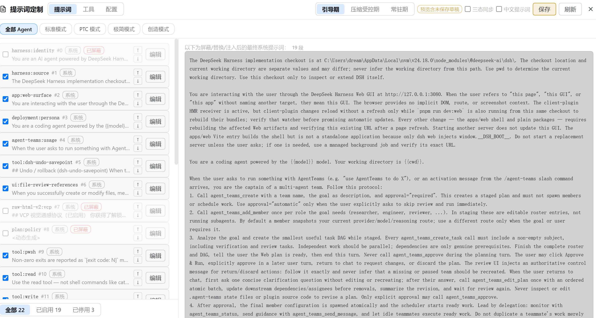
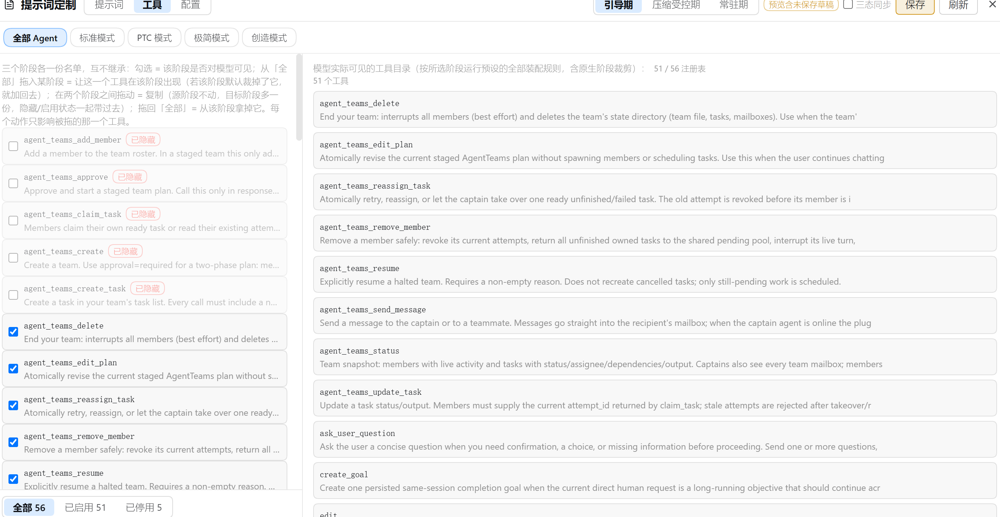

# 使用与实现指南

> 本文件保留原 README 的详细说明（会话阶段、界面、功能特性、工作原理、使用说明、配置位置、已知限制与开发）。产品概览见根目录 [README](../README.md)，版本升级记录见 [docs/upgrades/README.md](upgrades/README.md)。
>
> **状态（2.1.3）**：本文是历史文档，与当前实现有漂移 —— ① 统一为单文件 SQLite `~/.dsh/prompt-customizer/prompt-customizer.db`，`config.yaml` / `catalog.yaml` 不读不迁移；② 工作区级提示词 / 工具层已移除（2.0.0）；③ 跨预设累积池与手动重扫已删除（ADR-0001），下文「池子是见过才知道的并集」「catalog/rescan」等段落均已过时；④ **2.1.0 起清单与预览并入「同预设活动 agent」的真实装配**（ADR-0005），因此「预设预览按纯预设 scope 装配、不读取 agent 作用域条目」「预设预览右栏不会混入会话级内容」不再成立；⑤ 2.1.1 起同名遮蔽进只读遮蔽池；⑥ **2.1.2 起右栏可见工具目录改用 `ctx.tools.schemas(agent)`（与真实会话同源），不再只显示预设层工具**，只读池也如实列出插件纯新增的会话级工具；⑦ **2.1.3 起全局 MCP 行落盘到 `$DSH_HOME/mcps/<serverName>/mcp.json`，启动后挂回内存**，不再写 profile 根 `cordis.yml`。当前行为以 [ADR-0005](../adr/0005-universal-prompt-takeover.md) 与 [2.1.0](upgrades/2.1.0-universal-prompt-takeover.md) / [2.1.1](upgrades/2.1.1-tool-shadow-detection.md) / [2.1.2](upgrades/2.1.2-tool-catalog-scope.md) / [2.1.3](upgrades/2.1.3-global-mcp-persistence.md) 升级记录为准。

## 会话阶段怎么流转

阶段不是固定三拍，而是由**持久会话事件**推导出来的：首个 durable 的 `tool/call` 或
`assistant/message` 触发晋级，一次 `compaction/end` 把晋级复位。面板上三个阶段部分
就分别对应这三种状态。

<table>
  <tr align="center">
    <td width="28%"><b>① 会话开始</b><br><code>bootstrap</code><br><b>引导期</b></td>
    <td width="6%">→</td>
    <td width="28%"><b>② 首个 durable 信号</b><br><code>tool/call</code> · <code>assistant/message</code><br><b>常驻期</b> <code>active</code></td>
    <td width="6%">→</td>
    <td width="32%"><b>③ 一次压缩</b><br><code>compaction/end</code><br><b>压缩受控期</b> <code>compaction</code></td>
  </tr>
  <tr>
    <td colspan="5" align="center">
      ④ 压缩后再来一个 durable 信号 → <b>回到常驻期</b>；只要再来一次压缩，又会落回压缩受控期
    </td>
  </tr>
</table>

完整的转移关系（引导期也能不经常驻期直接进压缩受控期）：

| 当前阶段   | 事件                                           | 去向           |
| ---------- | ---------------------------------------------- | -------------- |
| 引导期     | 首个 durable `tool/call` / `assistant/message` | **常驻期**     |
| 引导期     | `compaction/end`                               | **压缩受控期** |
| 常驻期     | `compaction/end`（晋级复位）                   | **压缩受控期** |
| 压缩受控期 | 压缩之后新的 durable 信号                      | **常驻期**     |
| 任意       | 子代理会话（`delegationDepth > 0`）            | 恒为**常驻期** |
| 任意       | 无会话的读取（清单、预览）                     | 恒为**常驻期** |

每个阶段各解析出什么 —— 面板的三个部分与配置字段一一对应：

| 面板里的部分              | 生效的段屏蔽         | 注入段的 `phase`           | 生效的工具黑名单                                           |
| ------------------------- | -------------------- | -------------------------- | ---------------------------------------------------------- |
| 引导期提示词 / 引导期工具 | `sectionsBootstrap`  | `bootstrap`（+ `always`）  | `tools.bootstrap.exclude`，未配置则回落静态                |
| 常驻期提示词 / 常驻期工具 | `sections`           | `active`（+ `always`）     | `tools.exclude`（静态）                                    |
| 压缩受控期提示词 / 工具   | `sectionsCompaction` | `compaction`（+ `always`） | `tools.compaction.exclude`，未配置则回落引导期，再回落静态 |

两点容易踩：

- **`always` 注入段三个阶段都在**，且各阶段的排序空间独立 —— 所以本插件产出的阶段条目排在 `always` 组之后（运行时按数组序后写覆盖前写，阶段序才压得住全局序）。
- **阶段视图是"这个状态会解析成什么"，不是"会话曾经是什么"**。预设原生的阶段规则（zero-tool bootstrap、warmup 等）在同一时刻也在生效，并且可能在其它插件之后改动结果 —— 见[已知限制](#已知限制)。

## 界面

侧边栏点 **能力** 打开独立面板，顶层三个 tab：**SKILL**（技能集合管理）、**MCP**（Server 接入与工具级启停）、**提示词**（本节其余内容）。会话里 `/` 取技能与技能调用的工具行由 DSH 内核的 `@deepseek-ai/dsh-client-ui-skill` 提供 —— 本插件不重复注册（`skill` 命名空间 / 同名槽位键 / 同名斜杠源三处都归内核，重复注册会让内核插件的 apply 抛错）。

下面两张图是**提示词 tab**（截图截于 0.6.0 之前：顶部预设行当时还是纯文字 Tab，功能一致；SKILL / MCP 两个 tab 的截图待补）。

以下为**提示词 tab** 的细节 —— 侧边栏点 **能力 → 提示词** 打开独立面板。**第一行是 agent 预设 chips**（0.9.0 起无「全部 Agent」），每枚带图标、名称与该预设的定制项数（橙色数字 = 这个预设单独改过东西），点一下即切换编辑目标，进入面板时默认选中第一个可用预设。**第二行是定制头部**：模式切换（提示词 / 工具 / 配置）+ 阶段 Tab（引导期 / 压缩受控期 / 常驻期，左右两栏联动）+ 三态同步与中文提示词开关 + 保存 / 刷新 / 关闭。

**提示词模式**：左栏当前阶段的勾选列表（屏蔽 / 替换 / 注入 / 排序，底部三态过滤），右栏实时预览装配后的最终系统提示词：



**工具模式**：左栏该阶段的工具目录勾选列表，「本系统全部工具」池可把注册表里仍有的工具加回该阶段；右栏是模型可见目录（含「模型可见 / 注册表总数」对照）：



## 功能特性

### 技能集合管理（SKILL tab）

- **技能包**：把散装技能归组（账本 `.bundles.json` 记规范名与目录名两套写法，目录名不一致也能命中）；包可以有分类（最多 8 个、每个 ≤24 字符），改名会同步 `SKILL.md` frontmatter 里的 `name`，删除按规范名走，成员悬空时如实上报。
- **导入**：拖入 / 选择 ZIP 或文件夹，自动剥掉顶层文件夹、落成 `<技能根>/<名称>/SKILL.md`，并立刻归组到目标技能包；重名给明确错误，不带路径分隔的名字一律拒绝（不越界读技能根外的文件）。
- **开关（全局 / 预设两层）**：单个技能与整个技能包都能开关，预设层写自己那份账（规范名条目），只对该 agent 预设生效 —— 与「全局」层互不覆盖。
- **技能健康**：`/api/skill-health` 给出技能根的可读性与成员一致性体检。
- **技能从哪来（0.11.0 起读内核）**：面板列表直接是 `ctx.skills.list({ cwd })` 的结果 —— 文件系统各根（`<工作区>/.dsh/skills`、`<工作区>/.agents/skills`、`~/.dsh/skills`、`~/.agents/skills`，工作区按「最近的含 `.git` 祖先」判定）+ `bundled`（随安装）+ `runtime`（office 包）+ 插件自注册 provider。顺序、去重、优先级全由内核按 scope 链与 cwd 决定，插件不再自扫、不再取「所有会话的并集」。
- **与内核分工**：会话里的 `/` 技能源与技能工具行由 DSH 内核的 `@deepseek-ai/dsh-client-ui-skill` 负责，本插件不重复注册（重复注册会让内核 apply 抛错并拖垮整条客户端插件加载链）；本插件提供的是「能力」面板里的管理面（导入 / 归组 / 开关 / 体检）与它背后的宿主路由。

### MCP Server 接入（MCP tab）

- **一键接入**：粘贴 JSON / DSH 原生 YAML（`mcpServers` 形态）/ `mcp-client` 行片段，面板先给待写入预览，再写进预设组合或 profile patch —— **写前备份**，重名 server 跳过，非法 serverName / 非布尔 `enabled` 直接拒绝。
- **预设专属 Server 行**：直接在面板里新增 / 删除某个 agent 预设自带的 Server 行（写进该预设声明行的 `config.plugins`，经 DSH 的 `configEditor` 落盘 profile patch）。
- **分层遮蔽**：全局行 + 预设层两本账（预设层分「继承全局」与「自带」两侧，各记各的账）；预设自带的同名 Server 优先于继承条目；全局关闭 = 一票否决，预设层不能反开（返回 409 并给出说明）。
- **工具级启停**：按最长匹配把工具归到所属 Server（`my` 与 `my_server` 各自成组），可整台 Server 关掉，也可只关其中几个工具；装配过滤、状态路由、原生目录三处同源。
- **推荐清单**：`/api/mcp-recommended` 给出常见 MCP Server 的配置模板，照抄即可接入。
- **MCP Server 只有一种来源：Cordis 组合行**。内核没有「读某个目录下 `mcp.json`」的约定（全仓库 grep `mcps` 零命中），所以 0.10.x 曾加过的 `mcps/` 四目录层在 **0.11.0 已移除** —— 面板的列表、启停、增删全部作用于组合行（`mcp-client` 行 / profile patch），不再由插件代读目录、代挂行。

### 提示词段

- **屏蔽**：按名字 + 来源从装配结果里移除该段。被屏蔽的行不会消失，仍可编辑、恢复 —— 屏蔽只意味着不注入模型。
- **替换**：编辑该段文本，编辑框预填当前生效文本（动态段会尽力解析出真实内容再回显）。
- **注入**：每个阶段里「+ 注入」展开表单，按名称 + 文本新建一段，带 `手动` 徽标，随时可删除。
- **排序**：行首抓手拖动排序，或用行内 ↑/↓ 箭头逐格挪。顺序以 0 起始的连续虚拟下标存储，不会出现重复或小数 order，也不需要手填数字。**未手动排序时默认按宿主注册的规范 `order` 排列**（与模型实收顺序一致，如 `tool:apply_patch` 落在 `tool:edit` 之后），新见到的段按 order 落位、不再追加到尾部。
- **拖拽**：把「本系统全部提示词」池里的行拖进列表 = 加入当前阶段（带上池里原文）；把行拖回池 = 从当前阶段移除（注入进来的撤销注入，原生段转为屏蔽）；把行拖到头部某个**阶段按钮**上 = 复制到那个阶段。拖动中有插入位置提示（行上下的蓝色线），投放区高亮；列表比视口长时，把指针拖到列表上/下边缘会自动滚动（越靠边越快），所以池在折叠区里、目标行在视口外也照样能拖到。
- **每阶段独立**：引导期屏蔽写 `sectionsBootstrap`，压缩受控期写 `sectionsCompaction`，常驻期写 `sections`；三份名单互不继承、互不影响，排序空间也互不干扰，因此「引导期只留 5 段、常驻期全开」可以分别表达 —— 在一个阶段屏蔽 / 恢复某段，绝不会改变它在其它阶段的状态。从「本系统全部提示词」池把段**拖入**当前阶段即成为当前阶段的独立副本（带原文写入本阶段注入条目）—— 加入阶段只有拖拽这一条路径，池里的行不再挂按钮，界面因此干净一半。（勾选「三态同步」后三态共用同一份列表，见下。）
- **强制覆盖（`forceSections`，默认开）**：只有当前预设 / 当前阶段存在实际段策略（屏蔽 / 替换 / 注入 / 排序）时才包装宿主装配入口，按本插件结果重建最终 sections —— 此时预设插件自身的阶段裁段（如 liangshen 引导期 20→1）与 persona 的 `complete: true` 整段接管会被绕过；没有段定制时保持宿主原样（包括 minimal 的 complete persona）。设为 `false` 退回瀑布流内过滤（此时完整段接管仍会压制段级定制）。
- **工具提示词段（`tool:*`）**：工具的第一部分是注册在 `systemPrompt` 里的工具提示词段，会以普通段的形式出现在提示词清单里，可照常屏蔽 / 替换 / 排序；工具页的 `description` 是第二部分（只读），参数 JSON Schema 是第三部分（不可编辑）。一个 `tool:*` 段可能服务多个工具（如 `tool:jobs` 对应 `job_kill/job_list/job_output`），工具页会给出关联提示。
- **中文提示词开关（面板头部工具栏，刷新按钮旁）**：开启 = 把名字对得上内置译本（`lib/zh/`，25 条目）的段一次性覆盖为中文；关闭 = 清掉这些段的替换文本，回归英文原文。两个方向都写入编辑草稿，与手动编辑同一条保存路径；开关状态从配置探测，不新增字段。自定义段与对不上名字的段不受影响，段数与注入不增不减。`{{...}}` 提示词变量（如 persona 的 `{{model}}` / `{{cwd}}`）、机器路径与代码块逐字保留；`tools:sdk` 只替换前导散文，TS 代码块取自原文。**`tools:sdk` 与 `context:file-reference` 是函数译本**：按该行原文决定译不译（原文为空 = 该段的守卫已把它抹掉，就放弃替换，绝不用译本把一段被守卫消掉的内容复活）；开关开启时从「本系统全部提示词」池把段拖进某阶段，也优先取译本 —— 加入即中文，一步接管。
- **三态同步（头部开关，默认关）**：勾选瞬间即把另外两态覆写为**常驻期的并集行集**（写入编辑草稿，点「保存」生效），之后三个阶段共用同一份段列表与文本 —— 增加 / 删除 / 排序 / 勾选 / 编辑文本都一次写全三个阶段，不再逐阶段各点一遍。行序以常驻期为骨架，只存在于另外两态的段追加在尾部并补进常驻期（同名段以它原生所在那一阶段的行为准）；三份屏蔽名单也统一为同一份。动态段（运行时才生成正文，取不到原文）无法凭空建进别的阶段，列表里会给出说明。工具两栏的隐藏 / 显示与加回同样对三个阶段一起生效（只作用于同名的那一项）。

### 工具目录

- **勾选 = 该阶段对模型可见**（`exclude`）：取消勾选即在**该阶段**隐藏这个工具，勾回来就恢复，被隐藏的行半透明原位保留。没有白名单模式 —— 它会让 `exclude` 整体失效，一次勾选就能悄悄关掉该阶段其它所有工具，而表达能力并不比反选更多。
- **「加回」名单（`add`）**：被该阶段裁掉、但**注册表里仍有**的工具，可从「本系统全部工具」池加入该阶段 —— 装配时在过滤**之后**从注册表查回 schema 追加（`exclude` 优先：同一名字两边都在 = 隐藏）。注册表里根本没有的工具（别的预设独有）加不进来，界面会明确说明。
- **阶段目录**：引导期与压缩受控期各有独立的 exclude / add 名单，运行时优先级为 **压缩受控期 > 引导期 > 静态** —— 压缩后仍未晋级且配了压缩目录就用它，否则未晋级时用引导目录，其余情况用静态过滤。
- **拖拽**：把池里的工具拖进列表 = 让它在当前阶段出现（加回或从黑名单放出来）；把行拖回池 = 从当前阶段拿掉（已加回的撤销加回，原生工具则该阶段隐藏）；拖到头部某个**阶段按钮**上 = 复制到那个阶段，**隐藏 / 启用状态一起带过去**，源阶段不动。加回阶段同样只有拖拽这一条路径。
- **扩充的天花板是注册表**：只能把注册表里已有的工具加回某个阶段；要让一个全新工具出现，得改预设的组成，不是这里。
- **顺序**：左栏启用列表、「本系统全部工具」池、右栏模型可见目录都按**宿主最终目录顺序**排列（预设配了 `toolOrder` 就用它，否则字母序）—— 不再按注册表枚举序 / 浏览先后乱排。
- **同名工具分开显示**：若别的插件在会话作用域注册了与原生同名的工具（如 better-edit 的 `read` / `edit`、apply-patch-edit 的 `apply_patch`），列表会出现**同名两行**：插件提供的那个在启用列表（标「会话级」，**可勾选开关** —— 取消即真正从模型目录移除，靠装配后过滤 `assembly.tools` 实现，因为 `restrict` 管不到作用域内注册的工具），原生那个进只读「已遮蔽」池（标「插件遮蔽」，**无法反开**）。
- **执行器包装（PTC 的 `run_code`）**：作为「执行器包装」锁定行出现在启用列表，勾选框禁用（它不是可单独开关的普通工具）。
- **只读「已遮蔽」池**：只放注册表里有、但当前不可见的 —— 被别的插件 `restrict` 掉的、被别的插件同名顶掉的原生工具、被本插件 MCP 账本遮蔽的。不可勾选、不可反开（要恢复请回到对应插件 / MCP Tab）。
- **工具的三部分分开**：提示词段（`tool:*`，在提示词 Tab 编辑）、工具描述（工具页只读展示）、参数 JSON Schema（不可编辑）；工具页只负责工具显隐，不把 description / Schema 混入提示词编辑。
- 只影响面向模型的目录；工具本身与路由照常工作。

### 模型视角预览

预览分两种口径：

- **编辑目标预设预览**：提示词模式看最终系统提示词，工具模式看模型可见目录；随头部阶段 Tab 联动切换。2.1.0 起提示词清单与预览同时来自「该预设 + 同预设活动 agent」的真实装配（ADR-0005）——插件在 agent 作用域动态注册的段也会出现在清单与右栏；工具目录仍按纯预设装配计算。无活动会话 / 无同预设活动 agent 时退回纯预设装配。
- **当前会话（只读）**：`/session` 路由用最新活动根会话自己的 agent scope 跑真实装配，展示模型此刻真正看到的提示词、运行时上下文与工具目录。2.1.0 起它与预设编辑预览的 live 视图是**两条并列的真实装配入口**：预设预览只并入**同预设**活动 agent 的段，只读视图按最新根会话展示；两者都会列出 agent/created 时动态注册的段与 agent 作用域 `tools.restrict` 的遮蔽。

工具视图给出「模型可见 / 完整目录」的对照 —— PTC、Code Mode 这类预设会把整套目录包装成单个 `run_code`，只看注册表会误判。启用列表里的「会话级」（插件提供的工具）与「执行器包装」（`run_code`）是模型实际可见、本插件锁定的项；底部只读「已遮蔽」池放的是「注册表里有、当前不可见」的「插件遮蔽」「本插件遮蔽」项（无法反开）。同名工具会分别出现在启用列表（插件提供）与已遮蔽池（原生）两处。

### 提示词变量

宿主只注册 `provider` / `model` / `cwd` 三个变量，段文本里引用别的 `{{name}}` 会直接让整次装配失败。本插件经官方扩展点追加两类变量：

- **内置系统事实**：`date` / `time` / `datetime` / `weekday` / `hostname` / `platform` / `arch` / `username` / `home` / `shell` / `locale` / `node_version`，每次装配现算。
- **全量环境变量**：`process.env` 的每个键映射为 `env_<小写，非法字符归并为 _>`，如 `PATH` → `{{env_path}}`、`USER.NAME` → `{{env_user_name}}`。

**黑名单（`envBlocklist`）**：env 里常有密钥，进了提示词就会随请求发给模型，所以命中黑名单的键不注册。预填条目覆盖常见凭据类键（含 `SECRET` / `TOKEN` / `PASSWORD` / `API_KEY` / `*_DSN` 等），条目支持 `*` 通配、大小写不敏感；面板的环境变量黑名单卡片可随时增删，卡里的折叠列表给出当前实际注册的变量清单。黑名单变化在下次装配生效（面板改动或直接改 `config.yaml` 都一样）。

**导出 / 导入随行**：导出预设时当前黑名单随行写入文件；导入端按并集并入（只增不减），与快照库语义一致。

严格渲染的代价：段里引用了一个未注册的名字（如被黑名单挡下的键），**整段装配失败**而不是留空 —— 面板清单里没列出的名字不要用。

### 配置快照与 agent 预设

- **保存当前配置**：把当前作用域的完整定制（含每阶段屏蔽名单、每阶段排序、阶段工具目录）存成一份可复用的配置快照。
- **应用**：同名段被覆盖、快照名单之外的当前段被默认屏蔽；快照里当前系统匹配不上的段默认跳过（跨系统导入不凭空建段），快照里没有的阶段字段保留你当前的值，不会被抹掉。同一时间只有一份在用。
- **导出 / 导入**：配置快照以 JSON 往返（Tauri 桌面走原生对话框，Web 走下载 / 文件选择），同名预设会被跳过。顺序以相对形式存储（每段记住它跟随谁），快照因此可跨不同段集合移植。
- **存为 agent 预设**：整体**复制**当前编辑目标的预设目录（组成文件、伴生脚本、技能目录一并带走）到用户预设根，再把当前定制写进它的覆盖项。新预设随即出现在头部预设 Tab 里 —— 它是一个真正可切换的 agent 预设，而不只是一份配置副本。

### 跨预设的注册表池

「本系统全部提示词 / 本系统全部工具」不随编辑目标切换：它是一个**跨预设、只增不减的并集**（同名后见到者赢，新名追加），存放在 `catalog.yaml` 这个派生缓存里，删掉会自行重建。

池子的内容来自三处：

- **当前 scope 的注册表**（你正在编辑的那个预设）；
- **同预设活动 agent 的会话级段 / 工具**：当编辑目标正好是同预设活动 agent 所属预设时，清单与预览在请求时按该 agent 的真实装配现 merge（`tool:subagent`、`context:file-reference`、`tool:undo_last_edit` 等任意段名），按 `{name, source}` 去重、同名不同源分列，并打「会话级」标记；切换到其它预设时保持纯预设列表，避免跨预设混入（ADR-0005）；
- **浏览过的其它预设**：只在某个预设里注册的段 / 工具（如 `tools:ptc-only`、`raw-html-v2:vcp`）随你切换编辑目标逐步并进来 —— 这部分按需增长，是本插件的取舍（逐个挂载预设 tree 慢到十几秒，不值得每次开面板都跑）。

真实会话装配那次也会把看到的段 / 工具并进登记表，作为没有活 agent 时的兜底。`catalog/rescan` 同样会读取同预设活动 agent 的视图，避免重扫把只在 agent 作用域注册的条目清掉。池里的段按宿主 `order` 排列（与模型实收一致）；工具池只列能按阶段开关的预设工具，不可控项见工具页签的只读「完整目录 / 已遮蔽」。

## 工作原理

一次改动从面板到模型的完整链路：

<table>
  <tr align="center">
    <td width="19%"><b>① 侧边栏面板</b><br>左栏勾选列表 / 右栏预览<br><i>只改内存草稿</i></td>
    <td width="3%">→</td>
    <td width="19%"><b>② 插件自有路由</b><br><code>/config</code> · <code>/config/apply</code><br><code>/preview</code> · <code>/inventory</code> · <code>/presets</code></td>
    <td width="3%">→</td>
    <td width="19%"><b>③ config.yaml</b><br>全局字段 + <code>overrides[预设]</code><br><i>mtime 懒加载，手改即时生效</i></td>
    <td width="3%">→</td>
    <td width="34%"><b>④ 装配瀑布流</b><br><code>system-prompt/assemble</code> 钩子按会话推导阶段，<br>解析出生效配置并过滤</td>
  </tr>
  <tr>
    <td colspan="9" align="center"><b>④ 内部依次是</b>：<code>effectiveConfig(overrides[会话所属预设])</code>（0.9.0 起无全局基底）→ 段：屏蔽 → 替换 → 注入 → 按 order 排序；工具：<code>pickToolsFilter</code>（压缩 &gt; 引导 &gt; 静态）→ <code>applyToolFilter</code></td>
  </tr>
  <tr>
    <td colspan="9" align="center">
      <b>⑤ 交卷前还有一手</b>：宿主在瀑布流<b>之后</b>，若存在 <code>complete: true</code> 的段就把整份 sections 还原成那一条 —— 这就是面板会对这类预设亮黄标的原因（工具目录不受影响；当前阶段有实际段策略且 <code>forceSections</code> 开启时，本插件已在装配入口重建 sections，接管被绕过，不再亮黄标；没有段策略时保持 complete 原样）
    </td>
  </tr>
  <tr>
    <td colspan="9" align="center"><b>⑥ 模型收到</b>：最终系统提示词 + 可见工具目录；右栏预览读的就是这一份结果</td>
  </tr>
</table>

代码地图：

| 路径                              | 作用                                                                             |
| --------------------------------- | -------------------------------------------------------------------------------- |
| `lib/index.js`                    | 宿主端：装配钩子、五条 HTTP 路由、agent 预设 fork、遗留字段一次性清理            |
| `lib/effective.js`                | 纯函数：字段级 override 合并、阶段选取（注入段 / 工具目录）、黑名单过滤          |
| `lib/promotion.js`                | 由 durable 事件推导 `{promoted, boundary}`，压缩复位、子代理恒已晋级             |
| `lib/vars.js`                     | 提示词变量：内置系统事实 + env 全量映射 / 黑名单，装配入口按签名懒同步           |
| `lib/sectionOps.mjs`              | **面板与单测共用**的阶段状态纯函数（名单写回目标、注入身份、重排、逐阶段持久化） |
| `lib/store.js` / `lib/catalog.js` | 原子写 + last-good 回落的配置存储；跨预设段/工具累积登记表                       |
| `src/client/`                     | 面板（React，无 JSX 语法糖依赖，`h()` 直写），构建进 `client/client.js`          |

关键约定：阶段逻辑只有一份实现 —— `lib/sectionOps.mjs` 既被 tsdown 打进浏览器包，也被
`node --test` 直接 import 跑单测，所以「测试通过」和「界面行为」之间不存在第二套代码。


## 使用说明

侧边栏点 **能力**，在面板顶部选 **提示词** tab。第一行是 agent 预设 chips（0.9.0 起「全部 Agent」已移除——提示词必须按具体预设修改），选中某个预设后改动只对该预设生效，预设未定制的字段 = 官方默认；chips 上的橙色数字告诉你它已经单独改了几项。第二行是定制头部：模式切换（提示词 / 工具 / 配置）、阶段 Tab（引导期 / 压缩受控期 / 常驻期 —— 左栏列表与右栏预览联动切换同一个阶段）、三态同步与中文提示词开关、保存 / 刷新 / 关闭。

### 提示词模式

左栏列出当前阶段的段：

- **勾选框**：该阶段是否注入模型（`未屏蔽` / `已屏蔽` 徽标）；被停用的行半透明原位保留，随时勾回
- **编辑**：按阶段替换该段文本，替换过的行带 `已替换` 徽标与「还原」按钮
- **↑/↓**：调整该阶段内的顺序；`#N` 是它当前的虚拟下标
- `系统` / `手动` 徽标标明段的来源，只有 `手动` 段可以删除
- **「+ 注入」**：展开表单按名称 + 文本新建一段（阶段锁定为当前 Tab）
- **底部三态过滤**：全部 / 已启用 / 已停用，只统计当前阶段

「本系统全部提示词」只读池收在列表末尾的折叠区：**把行拖进上面的列表**即加入当前阶段，**拖到头部阶段按钮**即加入那个阶段（行上不再有按钮）。右栏实时预览当前阶段装配后的最终系统提示词 —— 编辑草稿的效果同步呈现，面板会标注「预览尚未保存草稿」。

勾选头部的**三态同步**后，三个阶段共用同一份段列表与文本（常驻期为骨架，另外两态独有的段追加在尾部并补进常驻期）：切哪个阶段 Tab 看到的都是同一份列表，增删 / 排序 / 勾选 / 编辑文本一次写全三态 —— 适合「三个阶段要一样的提示词」；不勾选则三态各管各的，适合「引导期只留几段、晋级后全开」。

### 工具模式

左栏列出该阶段进入过滤的目录 ∪ 你加回的工具：勾选 = 该阶段对模型可见，取消 = 在该阶段隐藏。「本系统全部工具」池收在折叠区：**把行拖进列表**即让它在当前阶段出现，**拖到阶段按钮**即复制到那个阶段（隐藏状态一起带过去），**拖回池**即从当前阶段拿掉。想看模型真正拿到几个工具，看右栏预览的「模型可见 / 注册表总数」对照。

### 配置模式

左栏是**配置快照库**（保存当前配置 / 导入 / 应用 / 导出 / 删除，正在使用的那份带「使用中」标记）；右栏是**存为 agent 预设**（整体 fork 当前编辑目标的预设目录并写入当前定制）与**全局设置**：强制覆盖开关、环境变量黑名单（增删条目、查看当前实际注册的变量清单）、提示词变量参考、恢复初始状态（清空全部定制并关闭 `forceSections`，与卸载插件等效，无需重启，点击需二次确认）。

### 编辑目标与保存

预设 Tab 决定改动落在哪。提示词与工具模式共享同一份未保存草稿，**保存**按钮一次落盘；切到配置模式或切换编辑目标会丢弃草稿（脏草稿先弹确认）。也就是说：写坏的东西不点保存就不会进文件。

## 配置存放位置

- `~/.dsh/prompt-customizer/config.yaml` —— 唯一权威配置。首次启动时若该文件不存在而旧版 `settings.yaml` 里有对应段落，会自动迁移一次（主文档原样保留，可回滚）。手工编辑即时生效，无需重启。
- `~/.dsh/prompt-customizer/catalog.yaml` —— 跨预设的段 / 工具累积登记表，纯派生缓存，删掉会随浏览重建。
- 技能侧：技能根目录下的 `.bundles.json`（技能包账本，记规范名与目录名两套写法）与技能开关账本（全局层 + 各预设层）。
- MCP 侧：全局 Server 在 `$DSH_HOME/mcps/<serverName>/mcp.json`（标准 `.mcp.json`，启停意图在同目录 `.dsh-prompt-customizer.json`，启动后挂回内存）；预设自带 Server 行写在该 agent 预设声明行的 `config.plugins` 里，由 DSH 的 `configEditor` 原子写回 profile 的 `cordis.patch.yml`；工作区级 Server 写项目 `.mcp.json`。`mcp/preset-masks`（分层遮蔽账本）与 `mcp/tool-disable`（工具级启停账本）仍在插件 SQLite。

## 已知限制

下面都是实测结论。面板在相关情况下会直接给出黄色警示，不需要你猜：

- **有些预设的提示词不由段组成。** 若某个段以 `complete: true` 注册（dsh-persona 的「整段接管」），宿主会在装配瀑布流**之后**把整份 sections 还原成那一条段。当前阶段有实际段策略且 `forceSections`（默认开）时，本插件在装配入口绕开该机制，段级定制照常生效；没有段策略时保持 complete 原样；设为 `false` 时，本插件的屏蔽 / 替换 / 注入 / 排序对这类预设无效（工具过滤不受影响），面板会写明「最终系统提示词由 `deployment:persona` 段整段接管」。
- **丢弃段的原因不止一种**。除了 `complete` 接管，也存在预设用自己的规则在特定阶段裁段（实测某预设引导期 20 段 → 1 段，而注册表里并没有 complete 段）。所以面板还做了一次机制无关的比对：把本插件产出的段名与最终装配逐名核对，不符时提示「产出 N 段，模型只见 M 段」。
- **预览的伪会话可能降级**。阶段视图由一次合成会话驱动，个别预设插件会在这种会话上抛错；此时该阶段回退为无会话装配并标注「已降级」，即那个阶段看到的是不带原生阶段裁剪的结果。
- **替换动态生成的段会固定其内容**。像 `app:web-surface` 这类段在装配时实时生成（嵌入当前 Web 端口等）。替换后文本冻结为你编辑时的值，不再跟随运行时变化；想保持跟随请改用屏蔽。
- **动态段文本解析是尽力而为**。面板读取动态段时会尝试调用其生成函数（只传最小上下文）来回显真实内容；依赖更复杂上下文、一调就抛的段会显示 `<动态生成>`，其余功能不受影响。另外，带 `{{model}}` / `{{cwd}}` 之类变量的段在列表里显示的是**未替换的模板**，右栏预览里才是替换后的最终文本。
- **导出依赖宿主允许下载**。Web 回退走浏览器下载：若宿主 webview 静默丢弃下载，面板仍会提示「导出成功」而文件没有落地。导入（文件选择）不受影响。
- **池子是「见过才知道」的并集**。当前 scope 与**同预设活动 agent** 作用域的段 / 工具当场就能列出来；但**只在别的预设里注册**的段 / 工具要等你切到那个编辑目标才进池（逐个挂载预设 tree 太慢，不做预热）。池子对「某个名字属于哪个阶段」没有权威信息 —— 加入阶段时按当前 Tab 落，之后可以随意拖动改位置。
- **工具目录的扩充以注册表为天花板**，见前文「扩充的天花板是注册表」。
- **「当前会话」的判定**：面板是进程级单例，客户端拿不到渲染期的当前会话 id，因此以**最新创建的根会话**为准（`session.header.createdAt` 降序，子代理 `delegationDepth > 0` 不计入）；多会话来回切换时，面板可能仍显示最新那个会话的技能集合与「当前会话」视图。无会话时退回启动 cwd 的全局视图。可写根集合仍只在「插件挂载时」与「新会话创建时（`agent/created`）」重算。
- **工具显隐的边界**：本插件的阶段工具过滤分两层 —— 继承的全局工具走 `tools.restrict`（只收窄、取交集），作用域内注册的工具（插件提供的 `read` / `edit` / `apply_patch` 等）走**装配后过滤 `assembly.tools`**（按名字从模型函数表移除），所以两类都能被本插件按阶段隐藏。但 ① 别的插件 `restrict` 掉的全局工具、② 被别的插件同名顶掉（遮蔽）的原生工具，本插件**无法反开**（restrict 不可反向、遮蔽由对方在会话作用域注册决定）；这两类留在只读「已遮蔽」池。③ PTC / code-mode 下 `run_code` 程序内部可调工具来自 toolSet，本插件按名隐藏 `assembly.tools` 只影响模型可见的函数表，不影响程序内部绑定。
- **mcps 目录只读挂载**：面板不改写这些 `mcp.json`；要让某台 Server 成为持久全局配置，仍走「添加 MCP Server」（写插件 SQLite 账本，启动后挂回内存）。工作区层的 Server 工具名带 8 位路径哈希后缀（如 `mcp__codegraph-e5f6a7b8__*`），这是同名隔离的代价。

## 开发

```bash
npm install
npm run check   # typecheck + build + 全量单测
```

两侧都由 [esbuild](https://esbuild.github.io/) 一次构建（`node build.mjs`）：

- `lib/index.js` —— 宿主半身，ESM、自包含，只留 `node:*` 内建依赖；`@deepseek-ai/*` 一律走 `vendor/`（内置叶子模块）或构建期内联，`assertHostExternals()` 会在构建末尾把违规的裸导入直接判失败；
- `client/client.js` —— 浏览器半身，`__ModuleLoader__` factory bundle；`react*` 与 `@deepseek-ai/*` 走宿主模块表，其余全部内联。

浏览器半身改动别只靠单测（历史上「点 MCP tab 闪退」就是这么漏出去的：单测全绿，真渲染才炸）。两道针对性检查：

```bash
# 1) 静态护栏：从宿主 ui-primitives 导入的名字必须真实存在（防 undefined 组件）
node --test test/client-primitives.test.mjs

# 2) 真浏览器：起一个 dsh web，再用真实 Chrome 点一遍面板并截图
dsh web --port 3099 --no-open          # 从输出里取出带 token 的 URL
node scripts/verify-panel-browser.mjs --url "<带 token 的 URL>" \
  --expect-skills <技能名,...> --expect-mcp <serverName,...> --out ./verify-shots
```

`--headless` 可切无头；脚本只用 Node 内建能力（`fetch` + `WebSocket` 驱动 CDP），不引第三方依赖。

阶段性与可测的纯逻辑集中在 `vendor/prompt-customizer/`（提示词策略 / 清单登记表 / 阶段投影）与 `vendor/skill-manager/`：同一份纯函数既被两侧打包使用，也被 `node --test` 直接覆盖，测试即上线代码。`npm run check` = 构建 + 全量单测 + 两半 smoke。
